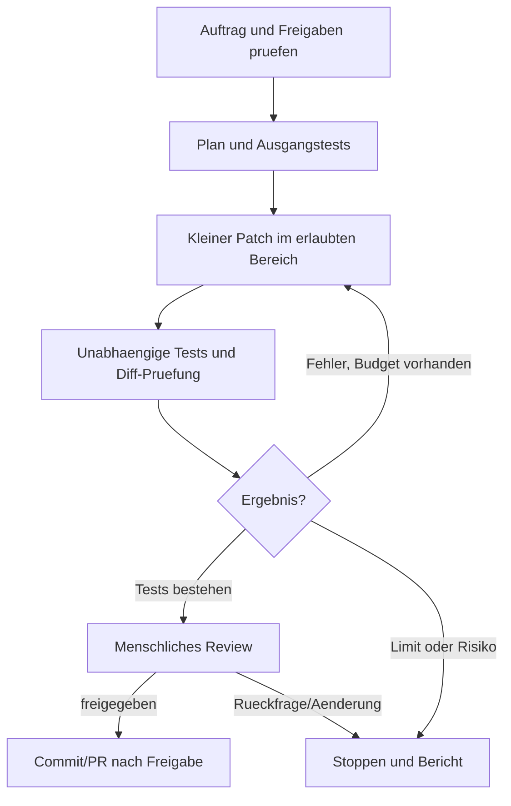

# Agentic Coding verstehen und sicher einsetzen

Einsteiger-Leitfaden fuer das Ultimate KI Setup, Stand 14.10.2026.
Die Beispiele sind **Entwuerfe und Uebungsaufgaben**, keine nachgewiesenen
Kundenprojekte, Erfolgsquoten oder Preisangebote.

## 1. Die Grundidee ohne Fachjargon

Ein normaler Code-Chat liefert dir beispielsweise eine Funktion. Du musst sie
in dein Projekt uebernehmen, ausfuehren und Fehlermeldungen zurueckmelden.
Ein Coding-Agent kann diese Schritte ueber freigegebene Werkzeuge selbst
uebernehmen: relevante Dateien lesen, einen Patch vorschlagen/anwenden,
einen Test starten und dessen Ergebnis fuer den naechsten Schritt verwenden.

**Agentic Coding ist werkzeuggestuetztes Entwickeln mit einem begrenzten
Planen-Handeln-Pruefen-Zyklus.** Es muss nicht vollkommen autonom sein.
Ein Mensch darf und soll an kritischen Stellen entscheiden.

Beispiel: "Erweitere die Kontaktliste um eine Suchfunktion." Ein sinnvoller
Agent liest die vorhandene Datenstruktur, klaert die Suchregeln, ergaenzt
gezielte Tests, implementiert einen kleinen Patch und legt einen Diff samt
Testbericht zur Pruefung vor. Er muss dafuer weder Produktionsdaten lesen
noch einen Server mieten oder eine Wallet besitzen.

## 2. Vier Ansaetze fair vergleichen

Die Begriffe sind keine trennscharfen Qualitaetssiegel. Ein Projekt kann
mehrere Ansaetze kombinieren.

| Ansatz | Wer steuert die Arbeit? | Typischer Nutzen | Typische Grenze |
|---|---|---|---|
| Klassische Entwicklung | Menschen mit Frameworks, IDE, Bibliotheken, CI und ggf. KI | gezieltes Engineering, Architektur- und Domaenenwissen | Aufwand bleibt; auch manueller Code kann schlecht sein |
| No-Code/Low-Code | Menschen konfigurieren visuelle Bausteine, teilweise mit Code | Formulare, Integrationen, interne Workflows | Plattformgrenzen, Betrieb und komplexe Sonderlogik pruefen |
| Vibe-Coding | informell ueber Prompts und sichtbares Ergebnis | Ideen und Prototypen schnell erproben | riskant, wenn niemand Code, Verhalten oder Datenfluesse prueft |
| Agentic Coding | Mensch setzt Ziel/Grenzen; Agent verwendet Werkzeuge und Feedback | wiederholbare, begrenzte Repo-Aufgaben und Testschleifen | kann ebenso falsche Anforderungen, unsicheren Code oder falsche Tests erzeugen |

Klassisch bedeutet nicht "jede Zeile von Hand", No-Code nicht automatisch
"unskalierbar" und Chat-Unterstuetzung nicht automatisch Spaghetti-Code.
Ein Agent ersetzt keine Spezifikation oder fachliche Abnahme.
Ein gutes Team erkennt Qualitaet an beobachtbarem Verhalten, nicht am Etikett.

## 3. Automat, Workflow und Conway Automaton

**Ein Automat/Zustandsmodell** ist ein allgemeines Informatik-Konzept:
Regeln legen fest, welcher Schritt auf welches Ereignis folgt. Ein Controller
kann beispielsweise nach drei gescheiterten Korrekturen zwingend stoppen.

**Ein Agent** trifft innerhalb seines erlaubten Rahmens dynamische Entscheidungen.
Seine LLM-Ausgaben sind nicht dadurch deterministisch, dass ein Zustandsdiagramm
existiert. Auch Temperatur 0 garantiert nicht dieselben Ergebnisse ueber
Modellversionen, Dienste und Laufzeitumgebungen hinweg.
LangGraph unterscheidet ebenfalls vorgegebene Workflows von dynamischen Agenten.
[Primaerquelle](https://docs.langchain.com/oss/python/langgraph/workflows-agents).

**Conway Automaton** ist dagegen ein bestimmtes Open-Source-Projekt mit
eigener Agentenruntime, Wallet-/Cloud-Funktionen und weitreichenden Werkzeugen.
Es ist keine notwendige Grundlage von Agentic Coding. Aider, OpenHands oder
ein eigener Graph koennen Coding-Aufgaben ohne Conway-Wallet erledigen.
[Projektquelle](https://github.com/Conway-Research/automaton).



Das Diagramm ist eine **Zielarchitektur**, kein bereits aktivierter Runner
dieses Repositories. Es werden dadurch keine Kommandos ausgefuehrt.

### Warum ein erfolgreicher Test nicht genuegt

Ein Agent kann denselben Irrtum in Implementierung und Test einbauen. Er kann
einen Test abschwaechen oder einen Fehler durch Entfernen einer Pruefung
"beheben". Deshalb fachliche Beispiele und verbotene Aenderungen vorher
festlegen, Baseline sichern und gezielte unabhaengige Negativtests verlangen.
Sicherheitsregeln und Abnahmetests nicht vom ausfuehrenden Agenten frei
ueberschreiben lassen. Ein Screenshot ersetzt weder API- noch Berechtigungstests.

## 4. Unser Tool-Baukasten

[Tool-Uebersicht mit Quellen und echtem Setup-Status](tools/agentic-coding.md).
Die meisten Tools sind bereits registriert; es werden keine doppelten
Installationen oder neuen Wallet-Abhaengigkeiten angelegt.

Fuer die erste Uebung reicht **ein** geeigneter Coding-Client plus vorhandenes
Modell, Git, ein freigegebener Testbefehl und menschliches Review. Mehr Agenten
bedeuten mehr Abstimmungsaufwand, Tokenverbrauch und Fehlermoeglichkeiten,
nicht automatisch bessere Ergebnisse.

Ein moeglicher Ausbau: LangGraph fuer explizite Zustandsuebergaenge,
Playwright fuer isolierte Browserchecks, Gitleaks/Semgrep fuer zusaetzliche
Pruefungen. Jeder dieser Bausteine braucht einen eigenen getesteten Betriebspfad.
Aider bietet upstream Lint-/Test-Feedback, etwa ueber `/test` bzw.
`--test-cmd` und `--auto-test`; das ist keine automatisch begrenzte
Korrekturschleife unseres Setups.
[Aider-Dokumentation](https://aider.chat/docs/usage/lint-test.html).

### Wo steht Automaton bei uns?

`Automaton` bleibt **planned/high-risk**. Nutzbar ist nur unser
[Offline-Vorschlagspruefer](tools/automaton.md), nicht die autonome Runtime.
Er validiert einen Vorschlag und fordert manuelle Pruefung. Er schreibt keinen
Code und fuehrt keine Tests, Shellbefehle oder Transaktionen aus.

```bash
# Nur Integrations-/Vorschlagspruefung, kein Conway-Start:
bash scripts/tools/automaton_install.sh --dry-run
python3 tools/automaton/review.py review examples/automaton/review-proposal.json
```

Eine spaetere Coding-Anbindung braeuchte einen separaten Broker mit festen
erlaubten Aktionen, isoliertem Repo, externen Zeit-/Kostenlimits und Review.
Keine privaten Zenbot-Keys, keine produktiven Cloud-Keys und keine
unbegrenzte Shell in den Agenten geben. Wallet, Replikation und
Selbstmodifikation bleiben dafuer gesperrt. Ein Genesis Prompt allein
erzwingt diese Grenzen nicht. Unser Pruefer ist keine OS-Sandbox.

## 5. Schritt fuer Schritt: die erste sichere Aufgabe

1. **Arbeitsbereich klaeren:** genau ein freigegebenes Uebungsrepo, synthetische
   Daten und ein benannter Bearbeitungsbereich. Keine WSL-/Service-Aenderungen
   durch dieses Tutorial; vorhandene lokale Aenderungen niemals still verwerfen.
2. **Ausgangslage ansehen:** `git status --short` und `git diff` lesen. Bei
   konkurrierenden Aenderungen im Aufgabenbereich stoppen und abstimmen.
3. **Auftrag vorbereiten:** die [Aufgabenvorlage](../examples/agentic_coding/TASK.md)
   kopieren/anpassen, ohne Secrets. Erfolg anhand von Beispielen definieren.
4. **Zuerst planen lassen:** betroffene Dateien, Risiken und Testbefehle
   benennen; noch keine Paketinstallation, Dateien aendern oder Befehle starten.
5. **Eng begrenzt freigeben:** kleiner Patch nur im vereinbarten Bereich.
   Auch Tests koennen beliebigen Code ausfuehren und brauchen eine Freigabe.
6. **Pruefen und begrenzen:** hoechstens drei Korrekturrunden nach dem ersten
   Versuch, maximal zehn Agentenschritte, zehn Minuten Laufzeit und ein Job.
   Das sind Beispielbudgets, die ein spaeterer Runner extern erzwingen muss.
7. **Ergebnis abnehmen:** Diff, echte Testausgabe und verbleibende Risiken
   selbst pruefen. Keine gefaelschten Testergebnisse oder Tests ohne Ausfuehrung.
8. **Erst danach veroeffentlichen:** Commit, Push, PR, Merge und Deployment
   sind getrennte Freigaben. Kein Direkt-Push auf main und kein automatisches
   `git reset --hard` oder Wegloeschen fremder Aenderungen.

```bash
# Diese Befehle installieren/starten nichts:
bash scripts/profiles/Agentic_Coding_Local_First_install.sh --dry-run
git status --short
git diff --check
```

Ein Auftrag sollte nach einem Blocker nicht stumpf weiterlaufen. Fehlende
Zugangsdaten, unerwartete Kosten oder gefaehrliche Seiteneffekte sind Gruende
zum Stoppen, nicht fuer autonome Umgehungsversuche.

### Beispielprompt

```text
Arbeite nur im freigegebenen Uebungsrepo am Kontaktfilter aus TASK.md.
Lies zuerst die relevanten Dateien und bestehenden Tests. Gib einen Plan aus.
Nach Freigabe: minimaler Patch, keine neuen Abhaengigkeiten, keine echten Daten.
Tests nur mit dem separat genehmigten Befehl. Bestehende Sicherheits- und
Abnahmetests nicht abschwaechen. Keine Netzwerkzugriffe oder Shell-Alternativen.
Maximal 3 Korrekturrunden; bei Budgetende oder Blocker stoppen.
Ergebnis: Diff-Uebersicht, ausgefuehrte Tests, Fehler und offene Punkte.
Keine Commits, Pushes, Deployments oder Wallet-/Service-Aktionen ohne Freigabe.
```

## 6. Konkrete Anwendungen und ihre Abnahmekriterien

Die folgenden Beispiele beschreiben realistische **Projektarten**, nicht
bereits durch unser Setup nachweislich fertig gebaute Unternehmenssysteme.

| Anwendung | Kleiner erster Auftrag | Was vor produktivem Einsatz zusaetzlich zaehlt |
|---|---|---|
| CRM-Erweiterung | Kontaktfilter mit Testdaten, Dublettenregel und Rollentest | OAuth, Quell-/Zielberechtigungen, Audit, Retry/Idempotenz, Konfliktbehandlung |
| ERP-/Business-Tool | Importvorschau fuer eine synthetische CSV | Transaktionen, Rundungen, Schema-Migration, Reconciliation und Restore |
| Landingpage/Web-App | responsive Seite mit Platzhaltern und lokalem Build | Accessibility, Formular-Backend, Security Headers, Auth, Betrieb/Updates |
| SaaS mit Zahlung | Testmodus-Webhook zweimal zustellen und eine Buchung erwarten | Signaturpruefung, Replay-/Idempotenzschutz, Rechte, Storno/Fehlerfaelle; kein echtes Geld im Test |
| Lead-Recherche | genehmigte Testquellen ohne Personenprofile strukturieren | Rechte/ToS, Datenschutz, Loeschprozess, Rate-Limits; kein Login-/Captcha-Bypass, keine automatische Kaltakquise |
| Dokumentenverarbeitung | synthetische Rechnung als JSON-Vorschlag klassifizieren | fachliche Abnahme, Berechtigungen, Fristen, Audit, keine automatische Buchung |
| Zenbot-Weiterentwicklung | vorhandenen synthetischen Backtest-Bericht auswerten | keine Live-Order, keine produktive Wallet; Strategie und Ergebnis unabhaengig pruefen |

Fuer persoenliche Daten gilt der [Personalakten-Leitfaden](tools/personnel-documents.md).
Ein allgemeiner Coding-Agent darf daraus keinen global lesbaren RAG-Index bauen.

**Beispiel CRM:** "Suche nach Firma, ohne Gross-/Kleinschreibung zu beachten."
Ein Test muss auch leere Suche, Umlaute, fehlende Firmenwerte und unzulaessige
Mandanten abdecken. Eine optisch funktionierende Liste ist kein Nachweis
einer sicheren Multi-Tenant-Anwendung.

**Beispiel Rechnung:** Ein Modell darf ein unsicheres Ergebnis als unbekannt
markieren. Gegenprobe mit Original, Summen-/Steuerlogik und Freigabe ist
wichtiger als ein huebsches JSON. Keine Datenbankbuchung nur wegen hohem
modellseitigem "Confidence"-Wert.

## 7. Kosten, Ressourcen und Stabilitaet realistisch planen

30.000 bis 50.000 Euro sind ohne konkrete Leistungsbeschreibung, Angebot und
Abnahmekriterien **kein belegter Vergleichspreis**. Auch "Tage statt Monate"
ist keine belastbare Zusage. KI kann Arbeit beschleunigen; Architektur,
Security, Integration, Migration, Tests und Wartung bleiben notwendig.
Vergleiche gleiche Funktionsumfaenge und den gesamten Lebenszyklus, nicht nur
die erste Demo. Erfolgsmetriken: benoetigte Reviews, reproduzierbare Tests,
Produktionsfehler, Aenderbarkeit und tatsaechlicher Aufwand.

| Zielhost | Sinnvoller Einstieg | Vorher pruefen |
|---|---|---|
| MiniPC/WSL2 | ein Client, ein kleiner Auftrag, vorhandenes lokales Modell | freier RAM/Swap, Linux-/Windows-SSD, Modellkontext und Buildlast |
| Oracle VPS | Queue/Orchestrierung oder kleine Tests, privat erreichbar | Kontingente, CPU/RAM, keine unkontrollierte Cloud-API oder Adminports |
| RPi/Home-Waechter | leichte Planung/Status, nicht grosse Parallelbuilds | ARM-Unterstuetzung und begrenzte Ressourcen |
| GPU-Workstation | ein lokaler Inferenz-/Buildjob nach Auswahl | Modell-/Kontext-VRAM, Strom, Platz, Aufwach-/Idle-Regeln |
| K3s | spaeter isolierte Jobs mit Ressourcenlimits | RBAC, Secrets, NetworkPolicy und Trust-Grenze; kein Host-Socket fuer Agenten |

Es gibt keinen pauschalen RAM-Mindestwert fuer "Agentic Coding". Client,
Modellgroesse, Kontext, Browser und Build bestimmen den Bedarf. Keine neuen
Hardware-Zusagen ohne Messung. Lokale Modelle sparen ggf. API-Gebuehren,
verursachen aber Ressourcen- und Stromkosten.

Die [bestehende Queue](JOB_QUEUE_AGENT_WORKER.md) ist keine Sicherheits-Sandbox.
Der derzeitige einfache Worker fuehrt Kommandotext ueber `bash -lc` aus;
mehrere separat gestartete Worker sind nicht als global exklusiv nachgewiesen.
Vor autonomen Auftraegen brauchen wir feste Task-IDs/Allowlist statt beliebiger
LLM-Shellstrings, einen exklusiven Lock, echte Prozess-/Ressourcenlimits und
kontrollierten Abbruch ganzer Prozessgruppen. Hier wird kein Worker gestartet.

## 8. Gedaechtnis, Wiederaufnahme und Qualitaets-Gates

`AGENTS.md`, Aufgaben-/Entscheidungsdateien und clientabhaengige Regeln koennen
Kontext erhalten. `.cursorrules` ist kein universelles Agentenformat; eine
`SOUL.md` aus Automaton kann vertraulich sein und darf nicht ungeprueft in
andere Runtimes oder oeffentliche Repositories wandern.

Speichern sollte man bereinigte Entscheidungen, Task-ID, Basis-Commit,
Diff-/Testreferenzen und den benoetigten naechsten Schritt. Keine Tokens,
Personalakten oder vollstaendigen vertraulichen Tool-Logs. Nach Neustart den
realen Git-/Dateizustand pruefen statt blind den letzten Status zu glauben.

Vor Merge: fachliche Beispiele, negative Rechtepruefungen, Lint/Tests,
Secret-/Dependency-Scan, unabhaengiges Review und nachvollziehbarer Diff.
Vor Deployment zusaetzlich Backup, Datenmigration, Restore-/Rollbackprobe,
Healthchecks und Betriebsverantwortung. Ein Git-Revert repariert keine
bereits versendete Mail, abgebuchte Zahlung oder migrierte Datenbank.

**Merksatz:** Nicht "der Agent darf alles, bis es irgendwie geht", sondern
"ein klarer Auftrag, begrenzte Rechte, nachweisbares Feedback und menschliche Abnahme".
