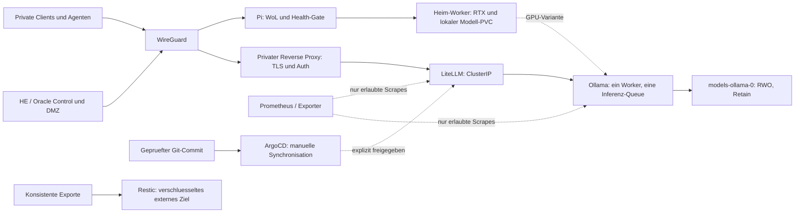

# LLMOps: Architekturabgleich und gezielter Ausbau

Stand: 03.11.2026; lokaler Arbeitsstand auf Basis `be3c210` inklusive noch nicht
committetem F01-F07-Patchsatz. Kein Online-/Produktionsstatus wird daraus abgeleitet.
Online-`main` wurde rein lesend auf denselben Commit `be3c21016963ba7335e4e5a2daca715a125b5ff6`
abgeglichen. Die beschriebenen lokalen Patches sind damit nicht automatisch auf GitHub verfuegbar.

## Kurzbewertung

Das eingereichte Review benennt wichtige Betriebsziele, stuft jedoch bereits vorhandene
Bausteine als fehlend ein. Der groesste Nutzen liegt aktuell bei verbindlichen
Ressourcenbudgets, realen Abnahmen und konsistenten Betriebsanleitungen statt weiteren Installern.
Git-Quellbuilds bleiben Standard; keine Docker-/Compose-Installation und kein Docker-Fallback.
Kubernetes benoetigt weiterhin eine explizit eingerichtete CRI wie containerd.

| Ziel | Bereits vorhanden | Tatsaechliche Luecke |
|---|---|---|
| Inference-Gateway | [LiteLLM Deployment, Service und ConfigMap](../k8s/base/litellm.yml), [CPU-Gateway-Konfiguration](../k8s/overlays/vps-cpu/gateway.yaml) | Modell-/Image-Pins, Auth-/Lasttest und API-Abnahme; keine belegte HA oder Budgetdurchsetzung pro Agent |
| Monitoring | [Monitoring-lite](../charts/monitoring-lite/), [Dashboard](../monitoring/grafana/dashboards/llmops.json), [lesender Ollama-Exporter](../scripts/monitoring/ollama_readonly_exporter.py) | Erreichbarkeit, Scrape-Auth, Alarmzustellung und echte gemessene Inferenzlatenz |
| Secrets | [SOPS-Konfiguration](../.sops.yaml), [gezielter Secret-Helfer](../scripts/security/apply_vps_sops_secret.py), Sealed-Secrets-Beispiele | Eigener Empfaenger/Trust-Root, Rotation, Schluesselbackup, etcd-Verschluesselung und Abnahme |
| Persistenz/Backup | [Ollama StatefulSet/PVC](../k8s/base/ollama.yml), [Restic-Exportpfad](../scripts/security/native_export_backup.py), [Velero-Rendering](../scripts/velero_setup.sh) | Echte konsistente DB-/Objektexporte, externer Restore und PVC-Wiederherstellung |
| GitOps | [AppProject und Application](../k8s/gitops/llmops-platform-app.yaml), [Bootstrap](../scripts/bootstrap_gitops.sh), bestehende Kustomize-Overlays | Voller Commit-Pin, gerenderte/pruefbare Artefakte und explizite Sync-Abnahme; kein Auto-Deploy |

Existenz einer Datei, Registry-Status und bestandene Offline-Fixtures sind keine Runtime-Freigabe.
Ein zusaetzlicher Helm-Chart fuer dasselbe Gateway wuerde derzeit eher Drift erzeugen.

## Zielarchitektur



Ollama selbst wird nicht am VPS-WAN veroeffentlicht. Keine automatische Cloud-Ausweichroute,
keine Modell-Downloads beim Deployment. Bei getrennten Clustern ersetzt ein ClusterIP keine
WireGuard-Route: Transport, Routing und Firewall benoetigen einen expliziten Vertrag.
Die Grafik ist ein Sollbild, kein Nachweis bereits verbundener Systeme.

## Priorisierte Befunde und Patch

**P0:** Historische Secret-Treffer klassifizieren/rotieren, Supply-Chain-Vertraege und sichere
Uninstall-Pfade fertigstellen. Der [F01-F07-Teilsatz](F01_F07_IMPLEMENTATION.md) bleibt massgeblich;
dieser Architekturpatch ersetzt keine offenen Sicherheitsabnahmen.

**P1:** Das CPU-Overlay erbte vor diesem Patch das Basisbudget von 24 GiB RAM-Requests und
48 GiB RAM-Limits, obwohl seine beiden Container zusammen nur 5 GiB RAM-Limits besitzen.
Die neue [CPU-ResourceQuota](../k8s/overlays/vps-cpu/resource-quota.yaml) begrenzt den Namespace auf
3 GiB RAM-Requests, 5 GiB RAM-Limits, ein 50-GiB-PVC und verbietet NodePort/LoadBalancer-Services.
Das ist ein Zulassungslimit fuer diesen Namespace, keine Reservierung des ganzen Hosts.
Monitoring, K3s und andere Namespaces benoetigen eigene Budgets und Systemreserve.

Die [Host-Vorpruefung](../scripts/quality/vps_host_preflight.py) verlangt zwei logische CPUs,
mindestens 6 GiB RAM gesamt, jetzt 3 statt 2 GiB aktuell verfuegbaren RAM sowie 64 GiB freie Disk
am Datenziel. Bei voller Nutzung der Limits plus OS/K3s/Monitoring ist **8 GiB RAM oder mehr**
sinnvoller; die Mindestpruefung beweist nicht, dass ein konkretes Modell hineinpasst.
CPU-Zaehler/RAM sind Hostwerte, keine Garantie fuer cgroup-Quoten innerhalb eines Pods.
Aktiver Swap fuehrt zur manuellen Vertragspruefung, niemals zu automatischem `swapoff`.
Ein Symlink-Datenziel benoetigt eine gesonderte Pfadpruefung.

Die Runtime-Statusabfrage ist auf zehn Sekunden begrenzt und prueft nur `is-active` fuer
`k3s`, `k3s-agent` oder `containerd`. Kein Start, Restart, Repair, CRI-RPC oder GPU-Test.
Eine aktive Unit beweist weder einen gesunden Cluster noch freie GPU-Kapazitaet.
Ebenso pruefen die vorhandenen Ollama-Probes `/api/version`, nicht die Anwesenheit oder
Inferenzfaehigkeit des gewaehlten Modells. Diese Abnahme getrennt und ohne automatische
Modell-Downloads durchfuehren; ein Ready-Pod ist noch kein erfolgreich getesteter Agenten-Backend.

**P2:** Lastmessung mit einem bereits vorhandenen Modell, Timeout-/Queue-Verhalten, Auth-Negativtest,
Scrape und Alarmzustellung nach Freigabe abnehmen. Kleine TSDB-Retention und keine Prompt-Volltexte
als Standard; Node-/GPU-Exporter nur mit erforderlichen Rechten. Kein erfundenes Ollama-`/metrics`.
Der vorhandene lesende Exporter nutzt standardmaessig Port 9404; die native Konfigurationsvorlage
und erlaubte Monitoring-Ports sind daran angepasst. Explizite private Ziele bleiben erforderlich;
es wird dadurch kein Exporter gestartet und kein oeffentlicher Port freigegeben.
Die bestehenden Default-Deny-Regeln erlauben neue Exporter nicht automatisch.
Insbesondere direkter Inventarzugriff eines Kubernetes-Exporters auf Ollama braucht einen
separaten konkreten Pod-/Namespace-Label-Vertrag und dazu passende Positiv-/Negativtests.

**P3:** Erst danach Gateway-Replikation und gegebenenfalls datengetriebenes Autoscaling entwickeln.
Verteilten Speicher oder zusaetzliche Operatoren nur nach belegtem Bedarf einfuehren.

## Warum kein pauschaler Ollama-HPA oder RWX-Cache?

Ollama hat bereits begrenzte Parallelitaet, Queue, Modellanzahl und Kontextgroesse.
Mehr Replikate erzeugen zusaetzliche Gewichts-/KV-Cache-Kopien und brauchen reale GPU-/RAM-Kapazitaet.
Ein CPU-HPA ist keine OOM-Sicherung und weckt keinen ausgeschalteten Heim-Worker.
Gateway-HPA benoetigt zusaetzlich konsistente Rate-/Budgetzustandsverwaltung und passende Quotas;
zwei Proxies bedeuten nicht automatisch zwei Inferenz-Backends.
[Ollama: Speicher und Parallelitaet](https://docs.ollama.com/faq).

`ReadWriteOnce` bedeutet Schreibzugriff von einem Node, nicht zwingend nur einem Pod.
`ReadWriteMany` macht einen Datentraeger nicht automatisch zu einem fuer parallele Ollama-
Downloads geeigneten Cache. Lokales K3s-Storage bleibt an den Speicher-Node gebunden;
ein Pod auf einem anderen Node erhaelt nicht automatisch dessen Modellgewichte.
Node-Ausfall kann deshalb zu Pending statt neuer Downloads fuehren.
[Kubernetes: Persistent Volumes](https://kubernetes.io/docs/concepts/storage/persistent-volumes/).

Die Basis setzt nun ausdruecklich `whenDeleted: Retain` und `whenScaled: Retain`, damit auch
GPU-/Produktions-Overlays den PVC-Erhalt dokumentiert erben. Kubernetes 1.32 oder neuer ist
fuer den hier vorausgesetzten stabilen Retention-Vertrag erforderlich. Nicht mit PV-ReclaimPolicy
verwechseln: ein spaeter manuell geloeschter PVC kann bei `Delete` weiterhin seinen PV verlieren.
Retention schuetzt weder vor Diskverlust noch vor geloeschten Modell-Dateien.
[StatefulSet-PVC-Retention](https://kubernetes.io/docs/concepts/workloads/controllers/statefulset/#persistentvolumeclaim-retention).

## Konkrete Dateien statt doppelter Deployments

- `deployment.yaml`: [CPU-Patches fuer Ollama/LiteLLM](../k8s/overlays/vps-cpu/deployment.yaml).
- `service.yaml`: [Agent-Zugriffspolitik](../k8s/overlays/vps-cpu/service.yaml);
  die eigentlichen ClusterIP-Services stammen aus der Basis.
- `pvc.yaml`: [Retention-Patch](../k8s/overlays/vps-cpu/pvc.yaml); der Claim entsteht weiterhin nur aus dem vorhandenen StatefulSet.
- `gateway.yaml`: [lokales LiteLLM-Routing](../k8s/overlays/vps-cpu/gateway.yaml), ohne automatische Cloud-Fallbacks.
- [Install-/Update-Automation](../scripts/operations/deploy_vps_baseline.sh): bestehend,
  jetzt mit begrenzter Runtime-Vorpruefung; kein zweiter Installer.

Die Templates enthalten absichtlich nicht erfundene Image-/Modell-Pins. Ein privates geprueftes
Overlay muss diese liefern. Quellbuild-Artefakte und deren gegebenenfalls benoetigte OCI-Verpackung
fuer containerd sind getrennt zu pruefen; dieser Patch installiert dafuer kein Docker.

## Plan, Freigabe und Anwendung

Die Befehle auf dem vorgesehenen Linux-Testhost ausfuehren, nicht blind auf dem Produktivcluster.
Der Standard des bestehenden Helfers ist `--check`. Auch `--plan` prueft lokal RAM/Disk/Runtime;
es ist kein reiner Offline-Rechner. Kubeconfig-/Clusterzugriff erst im expliziten Apply-Pfad.

```bash
# Lokale Hostpruefung, keine Installation/Reparatur:
bash scripts/operations/deploy_vps_baseline.sh --check \
  --data-dir /var/lib/rancher/k3s --runtime-unit k3s
# Nach Eintragen eigener Pins in einem privaten Overlay: rendern und strikt validieren.
read -r -p 'Absoluter Pfad zum geprueften Overlay: ' OVERLAY
bash scripts/operations/deploy_vps_baseline.sh --plan --overlay "$OVERLAY"
```

SOPS-Secret getrennt ueber den vorhandenen Helfer und einen ausdruecklichen Kubernetes-Kontext
verwalten. Keine Secret-Payload im Runtime-Apply; Base64 ist keine Verschluesselung.
ESO entschluesselt nicht einfach SOPS-Dateien aus Git; dafuer braucht es einen passenden
Decrypt-/Controller-Vertrag oder einen echten externen Secret-Store.
Fuer wenige lokale Dienste zunaechst einen solchen Weg abnehmen statt parallel Vault, ESO
und mehrere Decrypt-Controller zu betreiben. Jeder neue Secret-Store erzeugt eigene
Unseal-, Backup-, Upgrade- und Berechtigungsaufgaben.

Apply nur nach Host-/Image-/Storage-/Netz-/Secret-Abnahme ueber die bestehende separate Bestaetigung;
ArgoCD bleibt manuell synchronisiert und auf den geprueften Commit gepinnt. Nicht gleichzeitig
denselben Workload dauerhaft imperativ und durch GitOps verwalten.
[ArgoCD-Synchronisationsvertrag](https://argo-cd.readthedocs.io/en/stable/user-guide/auto_sync/).

## Abnahme, Breaking Changes und Rollback

Die CPU-Quota kann neue Pods, weitere PVCs oder eine Gateway-Hochskalierung ablehnen, die zuvor
das uebergrosse Budget ausnutzen konnten. Vor Apply vorhandene Belegung pruefen. Das Patchen
einer Quota beendet nicht automatisch bestehende Pods. Mehr als ein CPU-PVC erfordert einen
bewussten neuen Speicher-/Backup-Vertrag, nicht das Loeschen vorhandener Daten.

Die groessere RAM-Reserve und CPU-Pruefung koennen bisher akzeptierte Hosts ablehnen.
Runtime-Timeouts sind jetzt Fehler statt unbeschraenkter Wartezeit. Kein automatischer Rollback
per Namespace-Loeschung, kein PVC-Loeschen und kein `git reset --hard`.

Rollback: vorheriges geprueftes Overlay/Quota-Manifest nach Belegungspruefung zuruecknehmen;
den bestehenden Claim `models-ollama-0` und dessen Daten behalten. Bei Bedarf die PVC-Retention
auf `Retain` belassen, auch wenn andere Workload-Patches zurueckgenommen werden.
Das Rueckspielen eines Manifestes ist kein Daten-Restore und fuehrt hier nicht automatisch statt.

Offline-Abnahme: `tests/test_vps_delivery.py`, Kustomize-Rendering von Basis/CPU/GPU/Produktion,
vorhandene Produktionsbaseline-Tests und Dokumentnavigation. Live-CRI, Inferenz, GPU, Auth,
Alarmierung und Restore muessen getrennt freigegeben und wirklich getestet werden.

Lokale Ergebnisse (Windows, ohne WSL): VPS-Delivery 22 Tests, davon sieben Linux-Shell-Fixtures
ausdruecklich uebersprungen; Produktionsbaseline 13 Tests, davon sechs POSIX-Fixtures uebersprungen;
Dokumentnavigation vier Tests bestanden. Alle vier genannten Kustomize-Varianten rendern mit
Retention, das CPU-Overlay mit 5-GiB- statt 48-GiB-Limits. ShellCheck und Bash-Syntax des
Deploy-Helfers bestanden. Keine laufenden Dienste oder Cluster abgefragt.
Keine vollstaendige Linux-/Helm-/Kubeconform-/Runtime- oder GitHub-CI-Abnahme daraus ableiten.

Naechste kleine Abnahmeschritte: zuerst die Linux-Fixtures, dann ein privates Overlay mit
echten Artefakt-/Modell-Pins rendern, anschliessend Auth/Netzwerk und Inferenz im Testsystem
pruefen. Fuer die Heim-GPU separat Wake, SSH, NodeReady, GPU-Ressource und Modellbereitschaft
mit Zeitlimits nachweisen. Erst danach externen Restore und einen eigenen Testalarm abnehmen.
Keine zusaetzlichen Tools oder automatischen Deployments sind dafuer standardmaessig aktiviert.
