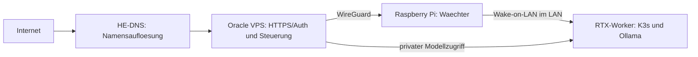

# VPS, Kubernetes, Ollama und OpenClaw - Ultimate Setup V11.17

**Vorschlag fuer eine Kurz-README, kein neuer Installer und noch kein Ersatz der
Root-README.** Relative Links beziehen sich hier auf `docs/`. Vor Uebernahme
muessen alte Abschnittsanker und Detailinhalte im Archiv erhalten werden.

## Einstieg

[Start Here](START_HERE.md) beschreibt MiniPC/WSL2, VPS und GPU-Worker getrennt.
[Aktueller Audit](AUDIT_2026_10.md) trennt Codebefunde, Tests und offene Abnahmen.
Die Plattform ist nicht allein durch vorhandene Skripte produktionsreif.

## Zielarchitektur



Dies ist das Zielbild, kein Nachweis eingerichteter Verbindungen. DNS ersetzt
keine Firewall. Modell-APIs und Managementports bleiben privat; Dashboards
benoetigen Authentifizierung und TLS beziehungsweise Zugriff ueber VPN.

## Gepruefter Installationsweg

Bootstrap und unabhaengigen Public Key zuerst vertrauenswuerdig bereitstellen.
Keine ungepruefte Shell direkt aus einem Download ausfuehren.

```bash
bash ./verify_release_and_install.sh --tag vX.Y.Z \
  --public-key /absoluter/separater/release.pub \
  --artifacts /absoluter/pfad/release-artefakte --verify-only
```

Der Befehl ist fuer den Repository-Root gedacht. `vX.Y.Z` ist ein Platzhalter;
ohne echte signierte Artefakte bleibt der Einstieg gesperrt. Erst nach Pruefung
und Quellcode-Review kann die Installation bewusst freigegeben werden.
[Details, Zwei-Schritt-Verfahren und Updates](SIGNED_RELEASES.md).

## Betriebscheckliste

- Vor Installation: Plattform, freien Linux-/Windows-Host-Speicher, RAM und Pin pruefen.
- Vor Update: lokalen Diff ansehen, verifizierte Repo-Sicherung erstellen lassen.
- Nach Update: Doctor/Healthchecks fuer den konkreten Runtime-Stand ausfuehren.
- Backup getrennt exportieren; Restore in isoliertem Ziel testen, nicht ueber Produktion.
- Secrets ausserhalb von Git halten; Rotation und Sperrung beim Anbieter dokumentieren.
- Cloud-Aufrufe nur mit bewusster Freigabe und wirksamen Budget-/Rate-Limits nutzen.
- GPU-/WoL-/Hardware- und Publishing-Aktionen bleiben opt-in.

## Anleitungen

| Thema | Einstieg |
| --- | --- |
| Tools und Integrationsstand | [Tool-Katalog](TOOLS_CATALOG.md) |
| Menue-/Registry-Abweichungen | [Vollstaendige statische Liste](audits/2026-10-27-registry-drift.md) |
| Kubernetes/Gateway/Storage | [VPS-GitOps-Deployment](VPS_GITOPS_DEPLOYMENT.md) |
| Kleine VPS / optionaler Bootstrap | [GitOps-Basis](GITOPS_SMALL_VPS.md) |
| Backups und Status | [Installationsstatus-Export](INSTALLATION_STATUS_BACKUP.md) |
| ENV-/Key-Export | [Verschluesselte Backups](CREDENTIALS_BACKUP.md) |
| Blockierte Installation | [Installations-Reset](INSTALLATION_RESET.md) |
| Verzeichnisse und Kompatibilitaet | [Struktur](DIRECTORY_LAYOUT.md) |
| Aktuelle Grenzen | [Abnahmematrix](TESTED_STATUS_MATRIX.md) |

## Begriffe

| Begriff | Bedeutung |
| --- | --- |
| Control Node | Steuert Workloads, muss keine grossen Modelle ausfuehren |
| GPU-Worker | Berechnet Modell-/Medienjobs, kann eine getrennte Strom-/WoL-Strategie haben |
| source-ready | Quellen vorbereitet; kein Nachweis einer fertigen Runtime |
| Dry-run | Nur dann nebenwirkungsfrei, wenn dieser konkrete Pfad dafuer getestet ist |
| GitOps | Deklarativer Sollzustand mit bewusst freigegebenem Controller |

## Lizenz und Grenzen

Projektlizenz: [Apache-2.0](../LICENSE). [Dritthinweise](../THIRD_PARTY_NOTICES.md)
gelten getrennt. Herkunft und Hashes sind pruefbar, Quellcode ist nicht
technisch unveraenderbar. Keine pauschale Sicherheits-/Lizenzfreigabe aus einer
Dateiliste, einem Menuehaekchen oder diesem Diagramm ableiten.
