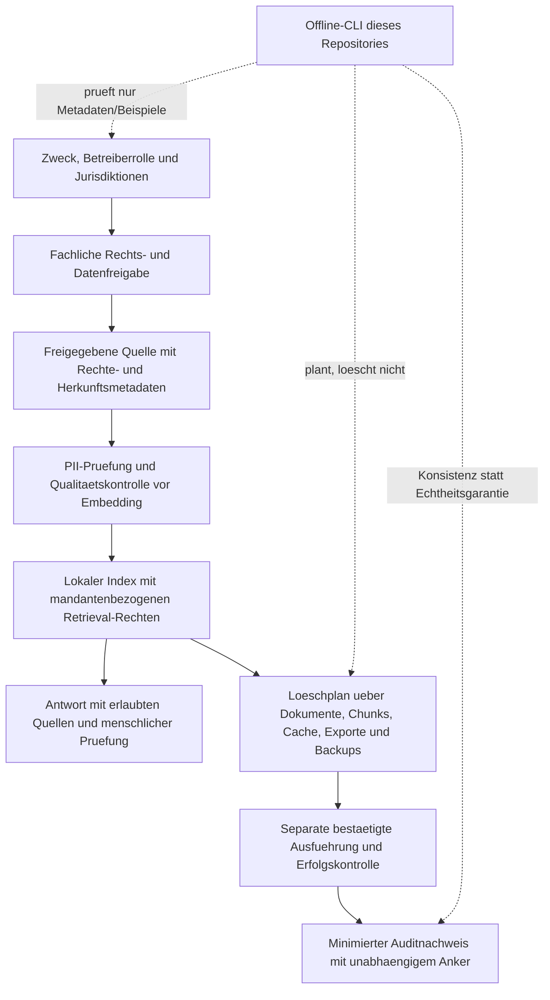

# RAG-Pruefarchitektur und Bewertung der gelieferten Beispiele

Die Anlage ist ein Konzeptgespraech mit Beispielcode, keine getestete
Produktionsimplementierung. Ungepruefte Zusagen wie "rechtssicher",
"produktionsbereit", "Zero Data Retention" oder "Admin-sicher unveraenderlich"
werden nicht in Systembeschreibungen uebernommen.

## Begrenzter Ablauf

### Ablauf als Text

1. Zweck, Betreiberrolle und betroffene Rechtsraeume bestimmen und fachlich freigeben.
2. Freigegebene Quellen mit Rechte-/Herkunftsmetadaten erfassen und vor dem
   Embedding auf personenbezogene Inhalte und Verarbeitungsqualitaet pruefen.
3. Den lokalen Index mit mandantenbezogenen Zugriffsrechten verwenden;
   Antworten auf erlaubte Quellen begrenzen und menschlich pruefen.
4. Loeschungen ueber Dokumente, Chunks, Caches, Exporte und Backups planen.
   Eine tatsaechliche Ausfuehrung braucht gesonderte Bestaetigung und Erfolgskontrolle.
5. Minimierte Auditnachweise mit unabhaengigem Anker vorsehen. Die Offline-CLI
   prueft nur Metadaten/Beispiele, plant ohne zu loeschen und prueft Konsistenz,
   nicht die Echtheit der Nachweise.

Keine dieser Pfeilverbindungen ist bereits ein aktiver Open-WebUI-/Qdrant-/
PostgreSQL-Adapter. Der Prototyp verbindet sich nicht mit laufenden Systemen.

## Komponenten aus der Anlage

| Komponente | Behandlung hier | Grenze / naechster notwendiger Nachweis |
|---|---|---|
| Globaler Rechts-/RAG-Prompt | [Ueberarbeitete Vorlage](prompts/GLOBAL_AI_RAG_REVIEW.md) | Keine automatische Aktivierung und keine Rechtsgarantie |
| PII vor Ingestion | Konzept mit [Presidio](https://github.com/data-privacy-stack/presidio); alter [Microsoft-Link](https://github.com/microsoft/presidio) leitet weiter | Nicht installiert; Modelle/Recognizer und Sprachqualitaet gesondert validieren |
| Qdrant-/Chroma-/pgvector-Loescher | Nichtdestruktiver Loeschplan | Keine Live-Loeschfunktion; Identitaet, Rechte, Legal Holds und Store-Abdeckung fehlen sonst |
| PostgreSQL-Schema und Cascade-Trigger | Designhinweise statt angewendeter Migration | Schema-/Rollen-/Transaktions-/Konkurrenztests in isolierter Testdatenbank erforderlich |
| Hash-Kette und Checker | Offline-Pruefer mit kanonischem JSON | Keine Unveraenderbarkeit, Signatur oder vertrauenswuerdige Zeitstempelung zugesichert |
| Exporter, Prometheus, Grafana, Alerting | Vorhandene Monitoring-Tools verlinkbar, kein Dienst eingerichtet | Monitoring zeigt technische Indikatoren, keinen DSGVO-Compliance-Score |
| Tamper-Simulation | Synthetische Fixture-Manipulation in Unit-Tests | Kein Trigger-Bypass oder Superuser-Test auf Nutzerdaten |
| repair_audit_chain | Bewusst nicht als automatisches Reparaturtool uebernommen | Originalbeweise bewahren; Re-Hashing kann Manipulationen verschleiern |
| Behoerdenexport CSV/Manifest | Exportanforderungen dokumentiert | Kein Live-DB-Export und kein unverdientes `chain_integrity_verified=true` |
| Compose/Dockerfile/Runner/ARC/KEDA | Nicht aktiviert oder installiert | Keine Docker-Sockets, PATs, CI-Runner, CRDs, Cluster- oder Cloudaktionen |
| DSB-Unterlagen | [Markdown-Template](templates/DSB_HANDOVER.md) | Keine vorweggenommene Abnahme oder Rechtsbescheinigung |
| Markdown nach HTML/PDF | Manueller spaeterer Exportpfad | WeasyPrint/Jinja2 nicht installiert; keine behauptete fertige PDF-Datei |

Presidio ist ein optionales Pruefwerkzeug und garantiert keine vollstaendige
PII-Erkennung. Kein stiller spaCy-/Transformers-Modell-Download. Fuer fremde
PDF-/Bild-/Audioinhalte sind zusaetzliche Parser-/OCR-/Sprachrisiken zu pruefen.
Eine Regex oder ein NLP-Treffer ist keine abgeschlossene Anonymitaetsbewertung.

## Konkrete Fehler und Schutzmassnahmen

| Problem in der Anlage | Warum unzureichend | Vorgesehene Massnahme |
|---|---|---|
| Nutzerhash wird "irreversibel anonym" genannt | Zusatzwissen, Schluessel und Verknuepfbarkeit koennen Personenbezug erhalten | Pseudonymisierung benennen, Schluessel getrennt, Zugriffe und Fristen pruefen |
| Gleiches Pepper/DB-Passwort im Beispielcode | Kein geeignetes Secret-Handling | Keine solchen Defaults uebernehmen; vorhandenen ENV-Tresor bewusst nutzen |
| Volltext aller Prompts/Outputs loggen | Datenschutz- und Secret-Risiko | Ereignisarten, Mengen, Zweck und minimale Nachweise statt Rohinhalten |
| Nur Dokumenttabelle kaskadierend loeschen | Externe Dateien, Cache, Vektorstore, Exporte, Backups koennen fortbestehen | Dokument-/Chunk-/Vector-Mapping und nachgelagerte Kontrollen je Speicher |
| "Letzten Hash lesen, neuen einfuegen" ohne Serialisierung | Gleichzeitige Schreiber koennen Ketten verzweigen | Sequenz-/Transaktionsdesign und Konkurrenztests; nicht aus Beispiel ableiten |
| SQL-/Python-Hash aus ungegrenzter Stringverkettung | Mehrdeutige Feldgrenzen und unterschiedliche Formatierung | Versionierte kanonische Serialisierung aller nachweispflichtigen Felder |
| Lineare Kette wird Merkle-Baum genannt | Andere Datenstruktur und Beweiseigenschaften | Korrekt als Hash-Kette bezeichnen |
| Trigger sollen selbst Admins stoppen | PostgreSQL erlaubt entsprechend berechtigten Rollen Aenderungen an Triggern | Rollen-/Admintrennung, externe Anker und Incident-Prozess; [ALTER TABLE](https://www.postgresql.org/docs/current/sql-altertable.html) |
| Abgeschnittenes Kettenende soll immer auffallen | Ohne bekannten Head/Anzahl kann ein gueltiges Praefix unveraendert aussehen | Unabhaengig gespeicherten und authentisierten Head/Anzahl vergleichen |
| Hash + Manifest sollen Beweiskraft garantieren | Angreifer koennen Datei und Hash zusammen ersetzen | Herkunft, Signatur/Schluessel, Chain of Custody und Uebergabeprozess getrennt nachweisen |
| CSV aus DB wird unkritisch als anonym bezeichnet | Benutzerkennungen und andere Zellen koennen personenbezogen oder als Formel interpretierbar sein | Feldminimierung, CSV-Formelneutralisierung, Empfaenger-/Berechtigungspruefung |
| Ephemeral Runner bedeutet vollstaendige Datenvernichtung | Volumes, Logs, Artefakte, Caches, Snapshots koennen verbleiben | Alle Persistenzorte und Fristen nachweisen; untrusted PRs nicht auf privilegierte Runner |
| DSB unterschreibt pauschal komplette Rechtmaessigkeit | Zu weitreichend und falsche Verantwortungsverlagerung | Beratung/Befunde dokumentieren, Betreiberentscheidung separat festhalten |

## Betrieb und Incident Response

Nur synthetische Daten fuer Integrationstests verwenden. Echte Loeschungen,
Datenbankmigrationen, privilegierte Rollen, Export und Modell-/Paketinstallation
brauchen jeweils eine gesonderte Freigabe. Verschluesselung, TLS, Zugriffsschutz,
Backup/Restore und Loeschfristen sind getrennte TOMs, kein ersetzendes KI-Prompt.

Bei Inkonsistenz: Verarbeitung begrenzen, Originale und externe Anker sichern,
Zugriffe untersuchen und Meldungs-/Benachrichtigungspflichten fachlich klaeren.
Ein technischer Fehler ist nicht automatisch eine meldepflichtige Verletzung;
ein gruener Hashcheck schliesst sie aber ebenfalls nicht aus.

Bei spaeterer PDF-Konvertierung nur vertrauenswuerdiges Markdown/HTML zulassen:
externe URL-/Dateiabrufe des Renderers begrenzen, keine Schluessel oder
personenbezogenen Falldaten in oeffentliche CI-Artefakte schreiben.

## Zeitliche Fassungen und Quellenpflege

[Rechtsaenderungen und Osteuropa](TEMPORAL_UPDATES_AND_EASTERN_EUROPE.md)
ergaenzt die Architektur um historische Intervalle, Wissensdatum und die
kontrollierte Aufnahme neuer Fassungen. Der Offline-Befehl `temporal-context`
filtert Metadaten, nicht Gesetzesauslegung. Webcrawler, Scheduler und produktive
Vektoradapter sind weiterhin nicht implementiert; vorhandene Indizes bleiben
unveraendert. Russland-bezogene Abrufluecken werden nicht als Rechtsfreigabe behandelt.
