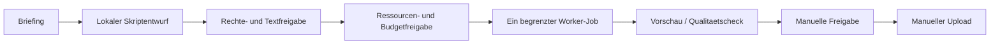

# Social-Media-Content mit lokalen KI-Avataren

Quellenstand: 14.10.2026. **Integrationsplan, keine fertig ausfuehrbare
Produktionspipeline.** Keine Installation, WSL-Aenderung, Cloud-Anfrage oder
Veroeffentlichung durch diese Erweiterung. Der beworbene Workshop/Erfolg
wurde nicht geprueft: Views, Follower, Einkommen und Rentabilitaet sind nicht garantiert.

## 1. Den Toolstack richtig verstehen

| Ebene | Beispiel aus dem Video | Lokaler Pfad / Grenze |
|---|---|---|
| Text, Storyboard | Sprachmodell/API | Ollama; Textmodell erzeugt nicht automatisch Video |
| Video/Szenen | Veo 3.1 | CogVideoX oder LTX-Video mit passender Pipeline, kein gleichwertiger 1:1-Ersatz garantiert |
| Avatar/Gesicht | spezialisierte Modelle | SadTalker, LivePortrait oder MuseTalk; verschiedene Eingaben/Aufgaben |
| Inferenz-Infrastruktur | fal.ai | lokale Worker/ComfyUI fuer Medien, Ollama/LocalAI/vLLM fuer passende Modellpfade |
| Graph/Mediensteuerung | ComfyUI | bereits vorhanden; Modelle und Custom Nodes gesondert auditieren |
| Orchestrierung | n8n | n8n oder bewusst gewaehltes Activepieces/Huginn/Windmill; nicht alle gleichzeitig |

fal ist eine Cloudplattform, nicht nur ein kostenloses OpenAI-Proxy.
Ein SDK auf GitHub macht weder die Plattform noch Veo selbsthostbar.
vLLM/TGI sind in diesem Plan Text-Inferenzpfade, keine pauschalen APIs
fuer Avatar-/Video-Modelle. LocalAI-Funktionen sind backend-/modellabhaengig.

Pinokio ist ein Desktop-Launcher fuer Skripte, **keine Container-Sandbox
und kein Ersatz fuer K3s**. Skripte koennen Befehle ausfuehren und Dateien laden;
eigene Verzeichnisse allein sind keine OS-Isolation.
[Offizielle Script Policy](https://github.com/pinokiocomputer/pinokio).
Docker/K3s sind optional; ein lokaler GPU-Worker reicht zum Einstieg.

## 2. Registry und Installationsstand

| Neuer Menueeintrag / ID | GitHub-Quelle | Zweck / Hinweis | Klasse |
|---|---|---|---|
| CogVideoX / `cogvideox` | [zai-org/CogVideo](https://github.com/zai-org/CogVideo) | Video-Modellpfad; fruehere THUDM-URL leitet um | gpu-heavy |
| LTX_Video / `ltx_video` | [Lightricks/LTX-Video](https://github.com/Lightricks/LTX-Video) | Video-Modellfamilie; Generation/Trainer/Adapter konkret auswaehlen | gpu-heavy |
| SD_Next / `sdnext` | [vladmandic/sdnext](https://github.com/vladmandic/sdnext) | optionale generative WebUI; kein notwendiger Zusatz zu ComfyUI | gpu-heavy |
| Pinokio / `pinokio` | [pinokiocomputer/pinokio](https://github.com/pinokiocomputer/pinokio) | optionaler Desktop-Launcher, fremde Skripte pruefen | medium |
| Windmill / `windmill` | [windmill-labs/windmill](https://github.com/windmill-labs/windmill) | Entwickler-Workflows mit separaten Workern/DB planen | medium |
| TGI / `tgi` | [huggingface/text-generation-inference](https://github.com/huggingface/text-generation-inference) | Maintenance Mode, kein bevorzugter neuer Standard | gpu-heavy |
| Fal_Client / `fal_client` | [fal-ai/fal](https://github.com/fal-ai/fal) | optionaler Cloud-Client; Dienstkosten/Uploads gesperrt | light, Cloud |
| Veo_API / `veo_api` | [googleapis/python-genai](https://github.com/googleapis/python-genai) | Google-SDK als moeglicher Client, kein lokaler Veo-Download | light, Cloud |

Alle acht: **planned/documentation-first**, Risiko high, keine aktiven Ports,
keine automatischen Installationen. Source-/Release-Pins, Smoke-Tests,
Preflight, Update-/Rollback und sichere Deinstallation fehlen noch.
Ressourcenklasse beschreibt nicht die gesamten externen Cloud-Rechenkosten.
Die gemeinsamen Guards verhindern eine falsche Installations-Erfolgsmeldung:

```bash
bash scripts/tools/social_media_candidate_install.sh --dry-run
bash scripts/tools/social_media_candidate_doctor.sh
```

Check/Doctor melden nur Registrierungsstatus, keine installierten Modelle,
keine Provider-Verfuegbarkeit oder GPU-Eignung. Install/Update/Uninstall
ohne Plan liefern Exit-Code 2. Bestehende Installationen werden nicht entfernt.

**Schon vorhanden:** ComfyUI, n8n, Ollama, LocalAI, vLLM, Activepieces, Huginn,
AUTOMATIC1111 sowie SadTalker/LivePortrait/MuseTalk sind registriert.
Vorhanden in Registry heisst nicht installiert oder end-to-end getestet.
Die bestehenden Avatar-/Alternativpfade sind teils planned.

AnimateDiff hat bereits einen Menueeintrag und einen Legacy-Python-Installer,
aber noch keinen eigenen maschinenlesbaren Registry-Eintrag. Dieser installiert
Bibliotheken, keine fertig eingerichtete ComfyUI-Motion-Pipeline.
Keine automatische Uminstallation: Konsolidierung bleibt TODO.
[AnimateDiff Upstream](https://github.com/guoyww/AnimateDiff).
Zeitliche/Identitaetskonsistenz und native Audioerzeugung nicht pauschal zusagen.

## 3. Lizenzen statt Werbeversprechen

- [ComfyUI](https://github.com/Comfy-Org/ComfyUI): GPL-3.0 laut Projekt;
  Custom Nodes und Gewichte gesondert pruefen. Lokale GUI kann auch Cloud-Nodes enthalten.
- [n8n](https://docs.n8n.io/sustainable-use-license/): Sustainable Use/Fair-Code
  mit Nutzungsgrenzen, nicht pauschal OSI-Open-Source oder uneingeschraenkt weiterverkaufbar.
- [Activepieces](https://github.com/activepieces/activepieces/blob/main/docs/about/license.mdx):
  Core MIT, Enterprise-/Cloud-Funktionen mit anderen Bedingungen.
- [Huginn](https://github.com/huginn/huginn): MIT.
- [Windmill](https://github.com/windmill-labs/windmill): AGPLv3 fuer den
  entsprechenden Source-Pfad; Enterprise-Features, mitgelieferte Binaerdateien
  und einzelne Komponenten getrennt laut LICENSE pruefen. Nicht pauschal MIT/Apache.
- [TGI](https://github.com/huggingface/text-generation-inference):
  Upstream Maintenance Mode; fuer neue LLM-Setups zuerst vorhandenes
  Ollama/vLLM bzw. unterstuetzte Alternativen bewerten.
- CogVideoX/LTX/Avatar-Gewichte separat von Code, Referenzbildern, Musik,
  Schriften und Stimmen lizenzieren. "Open weights" garantiert keine
  kommerzielle Freigabe und keine Rechte an abgebildeten Personen.

## 4. Einfacher Einstieg: ein kurzer lokaler Entwurf

1. Eigenes Angebot und Zielgruppe definieren, keine erfundenen Testimonials.
   Beispiel: ein kurzer, klar als KI gekennzeichneter Technik-Erklaerclip.
2. Ollama ein Skript/Storyboard vorschlagen lassen. Fakten, Produktangaben,
   Werbe-/Sponsoringhinweise und Rechte menschlich pruefen.
3. Eine fiktive Figur oder ein autorisiertes Referenzbild auswaehlen.
   Stimme lokal mit vorhandener TTS planen, keine fremde Stimme ungefragt klonen.
4. Genau **einen** Bild-/Video-/Avatar-Pfad pilotieren. SadTalker fuer
   Bild+Audio, LivePortrait fuer Portrait-/Bewegungsuebertragung und MuseTalk
   fuer Lip-Sync nicht blind gegeneinander austauschen.
5. ComfyUI-Graph, Gewichtsrevision und Node-Versionen dokumentieren.
   Keine unbekannten Custom Nodes automatisch installieren; diese sind ausfuehrbarer Code.
6. Einen freigegebenen Renderauftrag seriell mit Timeout und Speichergrenzen
   ausfuehren. Danach Gesicht, Stimme, Bewegung und Lesbarkeit pruefen.
7. FFmpeg/Schnitt fuer Ton, Untertitel und geplantes Plattformformat nutzen.
   Format-/Dauerlimits der Zielplattform vor Export aktuell pruefen.
8. Vorschau, Quellen/Rechte, KI-Kennzeichnung und manuelle Freigabe festhalten.
   Erst danach bewusst manuell hochladen; kein Autopublishing enthalten.

Nicht zuerst acht Programme installieren. Minimal: Textentwurf + genehmigte
kurze TTS-/Avatarprobe + Schnitt + Abnahme. B-Roll-Video spaeter separat ergaenzen.

## 5. OpenClaw/n8n: geplanter Workflow



[Workflowvertrag](../workflows/media/Social_Avatar_Content.md) und
[inaktive Planvorlage](../../examples/social_media/content-plan.example.json).
Kein importierbarer n8n-Flow, laufender Worker oder OpenClaw-Plugin implementiert.
Die Planwerte werden von keiner Runtime automatisch erzwungen.

OpenClaw plant Jobs/Pruefungen; kein beliebiger Shellstring aus Skripttext,
Caption, URL oder Modellantwort. n8n/Activepieces/Windmill/Huginn koennen
spaeter freigegebene, eng begrenzte Adapter koordinieren.
Eine gemeinsame GPU-Sperre muss **ueber alle** Werkzeuge gelten, nicht bloss
ein Worker pro Anwendung. Default: ein Job, begrenzte Versuche und Laufzeit.
Stop bei vollem Speicher oder Budget; kein stiller Cloud-Fallback.
Ein Timeout darf nicht blind erneut kostenpflichtige Generierung starten:
Job-/Provider-ID speichern und Status vor Retry abgleichen.

## 6. Veo/fal nur bewusst optional

[Veo 3.1](https://ai.google.dev/gemini-api/docs/veo) ist ein externer
Google-Videomodell-/API-Pfad, kein lokales Open-Source-Modell.
Unterstuetzte Features, Modell-IDs, Verfuegbarkeit und Preise vor jeder
Integration offiziell pruefen, nicht aus dem Workshop ableiten.
[fal-SDK](https://github.com/fal-ai/fal) ist ein Client/Cloud-Deployment-Pfad.
Es ersetzt nicht automatisch eine lokale ComfyUI-Installation.

Beide sind standardmaessig gesperrt: kein Key erforderlich, keine Uploads,
keine Zahlungen oder Netzwerkaufrufe. Spaeter nur mit expliziter Freigabe
fuer Provider, Modell, Referenzmedien, Kosten pro Auftrag und Tagesbudget.
Providerseitige Limits zusaetzlich zu lokaler Budgetpruefung setzen.
Keys nur privat ausserhalb Git, keine Tokens oder signierten Medien-URLs
in Queue-/Audit-Logs. Automatische Cloud-Fallbacks koennen Datenschutz und Budget verletzen.

## 7. Ressourcen und Hostrollen

| Host | Aufgabe | Vor Aktivierung pruefen |
|---|---|---|
| MiniPC / WSL2 | Skript, Planung, kleine TTS-/Schnittprobe | RAM/Swap, echte freie Host-SSD, Cache/Tempdateien |
| Raspberry Pi | Queue-/Wake-Steuerung | leichte Jobs; keine Zusage fuer Videodiffusion |
| Oracle VPS | private Control Plane/Workflowstatus | keine oeffentliche ComfyUI-/Ollama-/OpenClaw-/DB-API |
| GPU-Workstation | ein Avatar-/Videojob | CUDA/PyTorch, Modellgewichte, RAM/VRAM, Frames/Batch/Offload |
| K3s | optionales Worker-Scheduling | GPU/PVC-Quota, gemeinsame Jobgrenzen, VPN; kein gemeinsamer VRAM-Pool |

Keine pauschale Zusage fuer RTX 5080 oder einen beliebigen 8-/16-GB-Grafikspeicher.
Aufloesung, Videolaenge, Modellvariante und Offload bestimmen Bedarf und Tempo.
Lokal entfaellt eventuell die Providergebuehr, nicht Strom, Hardware,
Speicher, Einrichtung und Nachbearbeitung. Erst einen kurzen Pilot messen.

## 8. Sicherheit und offene Aufgaben

Keine echten Personen ohne nachweisbare Einwilligung imitieren; keine
irrefuehrenden Experten, Empfehlungen oder Identitaeten. Rechte an Stimmen,
Bildern und Musik vor Verarbeitung klaeren. KI-Kennzeichnung und jeweilige
Plattform-/Werbevorgaben pruefen. Keine Wasserzeichen-/Sicherheitsfilter-Umgehung.
Kein Spam, Massenkonto-Betrieb, gefaelschte Interaktionen oder Reichweitengarantie.

Listener spaeter nur localhost/VPN, keine --listen/--share-Freigabe als Default.
Keine offenen Container-Sockets, keine Admin-Credentials fuer Medienworker.
Projekte/Originalmedien ausserhalb Git und mit privater Zugriffskontrolle speichern.

TODO: reale versionsgepinnte Installer, ComfyUI-API-Graph/Adapter,
gemeinsame GPU-Sperre, Rechte-/Freigabebelege, echte Budgetdurchsetzung,
begrenztes Provider-Polling und wiederaufnehmbare Jobs testen.
Beide Cloud-Pfade und alle neuen Tools bleiben bis dahin planned.
