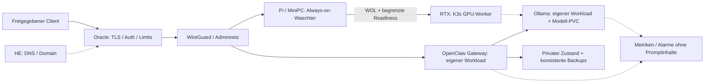

# Ultimate Setup: private hybride AI-Infrastruktur

**README-Vorschlag vom 23.10.2026, nicht Ersatz der bestehenden README.**
Ziel: HE/Domain vorne, Oracle steuert, Pi weckt, RTX rechnet. Kubernetes, Ollama
und OpenClaw bewusst getrennt und nur ueber gepruefte private Grenzen betreiben.
Das Repository ist derzeit eine umfangreiche Installer-/Dokumentationssammlung,
keine abgenommene produktionsreife Komplettdistribution.

## Architektur

## Vor dem Setup

1. [Aktuellen Nachweisstand](../CURRENT_STATUS.md) und
   [kritische Auditbefunde](../AUDIT_2026-10-23.md) lesen.
2. [Erste 60 Minuten](../FIRST_60_MINUTES.md): Herkunft und Offline-Fixtures,
   keine Masseninstallation oder persoenlichen Hosts als Testsysteme.
3. Zielpfad waehlen: kleine native Basis oder ausdruecklich gewaehlter K3s-/GPU-Pfad.
   GitHub-Source bevorzugen; apt nur fuer freigegebene System-/Buildabhaengigkeiten.

## Setup nach Umsetzung der geplanten PRs

- Hostzustand ueber idempotente Ansible-Rollen, Oracle-Ressourcen ueber OpenTofu.
- Verifizierte Tool-/Image-Pins; feste Zielplattform und Lock-/Provenienzdateien.
- Secrets ausserhalb Git bereitstellen; keine echten Werte in ENV-Beispiele kopieren.
- Workloads lokal rendern/validieren und erst auf Wegwerf-VM/Cluster abnehmen.
- [Konfigurationsvorschlaege](PRODUCTION_CONFIGURATION_DRAFTS.md) sind Entwuerfe;
  sie duerfen erst nach Schliessen der dort genannten Voraussetzungen aktiviert werden.

## Betrieb

[Runbook](PRODUCTION_CONFIGURATION_DRAFTS.md#11-runbook-nach-freigabe-und-deployment):
Start/Stop, Update, Log-Analyse, Modellwechsel und Disaster Recovery.
Single-GPU-/RWO-Baseline hat geplante Downtime, kein automatisches HA.
Gruene Prozessprobes beweisen noch keine richtige Inferenz oder sichere Skills.

## Sicherheit

Ollama, Gateway, Kubernetes-API, Datenbanken und Home Assistant nicht direkt ins
Internet stellen. VPN allein ersetzt keine Gateway-Authentifizierung.
Nicht-root, minimale Capabilities, kein Docker-Socket, eigene Volumes und
explizite Egress-/Toolregeln; destruktive oder reale externe Aktionen nur nach Freigabe.
Vorhandene Secrets/Workspaces niemals durch Update oder Uninstall entfernen.

## Troubleshooting und Status

- Pending: Ressourcen, Node-Affinity/GPU-Plugin, PVC und fehlende Secrets pruefen.
- Nicht ready: Startup/Config/State und kompatible Probe-Endpunkte pruefen.
- Gateway ohne Antwort: DNS/NetworkPolicy/Modell-ID und explizite Cloud-Policy pruefen.
- Wenig Disk/RAM: aktuelle Operation abbrechen/diagnostizieren, keine Sicherheitsreserve umgehen.
- Backup: Fehler weiterreichen; Restore in frisches Ziel beweisen, nicht nur Archive zaehlen.

Bewertung und Umsetzung:
[vier Phasen](PRODUCTION_BASELINE_2026-10-23.md),
[konkrete PR-Vorschlaege](../SETUP_REVIEW_2026_CODEX.md),
[offene Roadmap](../ROADMAP_NEXT.md).
Keine Produktionsfreigabe aus Dokumentationsumfang oder Tool-Markern ableiten.
