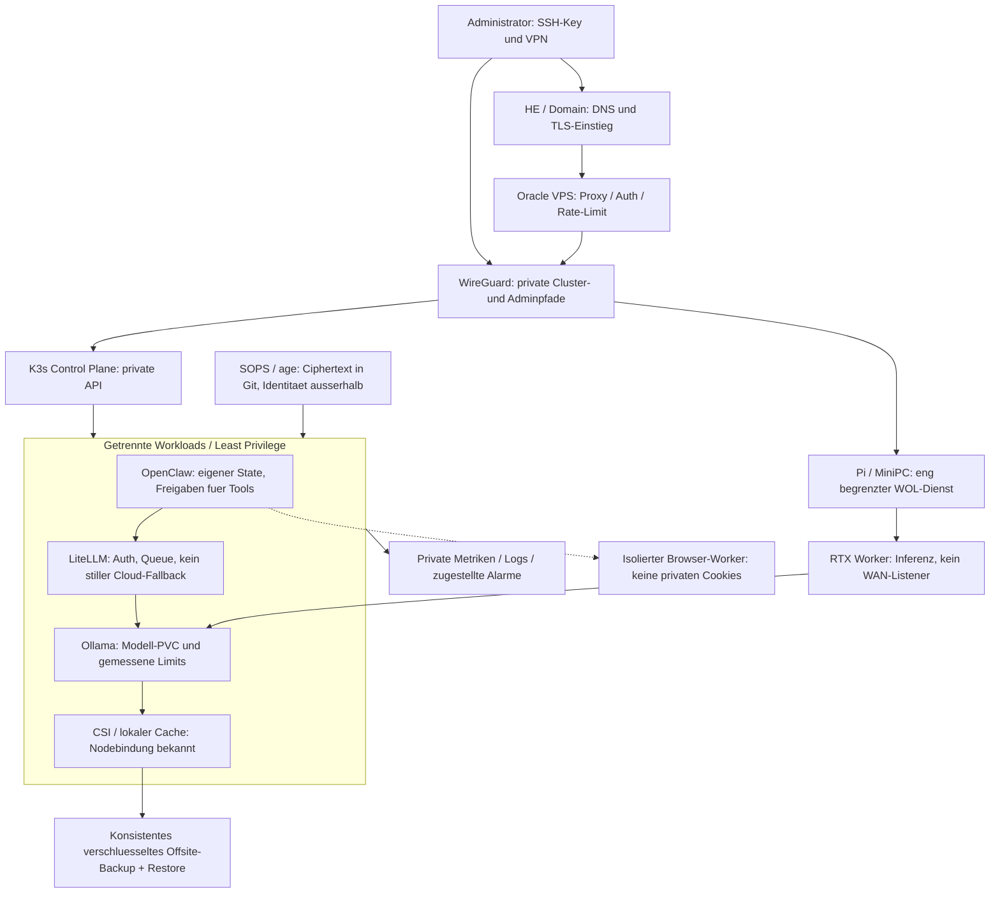

# Sicherheits- und Architekturaudit: Hybrid-LLMOps

Stand: 25.10.2026. Belegter lokaler Ausgangscommit:
`152cce67cb0a76b189aa548d31f32696de8d78be`. Arbeitsbaum bei Beginn sauber.
Die oeffentliche GitHub-Seite wurde gelesen; Remote-main wurde nicht abgeholt
oder als identisch bestaetigt. Zeilenbelege beziehen sich auf diesen lokalen Stand.

## Entscheidung

**Keine pauschale Produktionsfreigabe.** Die neue Kustomize-Basis ist ein
brauchbarer Ausgangspunkt. Aeltere Installations-/Deploymentpfade umgehen aber
mehrere ihrer Schutzregeln. Vor produktivem Betrieb einen einzigen freigegebenen
Pfad waehlen, nicht dieselben Dienste parallel auf Host, Compose und K3s starten.

Dies ist ein statischer, risikoorientierter Review der Kernplattform, **kein
vollstaendiger Penetrationstest aller Tools**. Keine echten Secrets, laufenden
Ports, Host-Firewalls, Cloud-Accounts oder Cluster wurden untersucht. Keine
CVEs fuer unbekannte installierte Versionen behauptet. Es wurde nichts deployt.

Gepruefte Bereiche: `k8s/base`, beide Overlays, alter Kubernetes-Sammelmanifest,
Hostinstaller/-uninstaller fuer OpenClaw/Ollama/K3s, Gateway-Vorlage, Compose-
Stack samt Routerkonfiguration, UFW, Ansible-Bootstrap, Backup und Baseline-CI.
Vorheriger [Architekturreview](../ARCHITECTURE_REVIEW_2026-10-25.md) bleibt
historischer Kontext; unten stehen neu am aktuellen Stand gepruefte Belege.

## Priorisierte Befunde

P0: vor destruktiven/Datenaktionen; P1: vor produktivem Anschluss; P2: danach.
Die Einstufung beschreibt das Risiko des Codepfads, keine nachgewiesene Attacke.

| ID | Prioritaet | Beleg | Risiko | Massnahme / Abnahme |
|---|---|---|---|---|
| S01 | P0 kritisch | [OpenClaw-Uninstall:23](../../scripts/tools/openclaw_uninstall.sh#L23), [98](../../scripts/tools/openclaw_uninstall.sh#L98) | ENV-bestimmtes Ziel wird privilegiert rekursiv geloescht, ohne engen kanonischen Besitznachweis. | Root/Home/Symlinks/fremde Ziele ablehnen; Programm und Daten getrennt behandeln; Negativtests in Wegwerf-VM. |
| S02 | P0 hoch | [Ollama-Uninstall:26](../../scripts/tools/ollama_uninstall.sh#L26) | Modelldaten werden zusammen mit Programm entfernt. | Daten standardmaessig erhalten, gesondertes Purge mit bestaetigtem Backup. |
| S03 | P0 hoch | [Backup:16-29](../../scripts/operations/backup_run.sh#L16) | Beide rsync-Fehler werden ignoriert; Abschluss kann trotz unvollstaendiger Sicherung Erfolg melden. Weitere Workspace-Secrets koennen unverschluesselt kopiert werden. | Fehler propagieren, Teilstatus und verschluesseltes Offsite-Backup; isolierter Restore als Abnahme. |
| S04 | P1 hoch | [LoadBalancer:232](../../scripts/k8s_deployments.yaml#L232), [Cloudrequest:261](../../scripts/k8s_deployments.yaml#L261), [Flask:290](../../scripts/k8s_deployments.yaml#L290) | LoadBalancer vor Flask-Endpoint ohne dortige Authentifizierung; zuerst Cloud-Anfrage. Query-API-Key kann in Fehlerdiagnosen gelangen. Ein tatsaechlich oeffentlicher Listener ist nicht nachgewiesen. | Legacy-Pfad aus Produktionsauswahl nehmen; nur VPN/TLS/Auth-Gateway, Credential-Redaktion. Keine stille Cloud-Uebertragung. |
| S05 | P1 hoch | [Ollama-Installer:26](../../scripts/tools/ollama_install.sh#L26), [K3s:7](../../scripts/tools/k3s_install.sh#L7) | Veraenderliches Remote-Skript direkt in Shell. | Pin und Integritaetspruefung vor Ausfuehrung; Source-/Artefaktbau getrennt vom Dienststart. |
| S06 | P1 hoch | [OpenClaw-Installer:31-54](../../scripts/tools/openclaw_install.sh#L31) | `git pull`/Clone und `pnpm install` ohne festen Commit-/Frozen-Vertrag; kein dedizierter Gateway-Dienst daraus ableitbar. | Gepinnter Build, Non-Root-Runtime, eigener State, erlaubte Tools/Skills und Auth am echten Gateway pruefen. |
| S07 | P1 hoch | [ENV-Manager:57-72](../../scripts/llmops_platform_config_manager.sh#L57) | Kopiert ENV ins Repo-Verzeichnis ohne explizit atomaren 0600-Schreibvertrag; Werte werden ersetzt. | Externe servicebezogene Secrets, Symlinkschutz und explizites Replace. Keine echten Inhalte fuer den Audit ausgeben. |
| S08 | P1 hoch | [Compose:6](../../stacks/llmops-platform/docker-compose.yml#L6), [Fallback:17](../../stacks/llmops-platform/litellm-config.yaml#L17) | Mehrere Dienste teilen eine ENV; lokale Ausfaelle koennen Anfragen an Cloudmodelle routen. | Secret-Allowlist je Dienst, Cloud standardmaessig aus, Freigabe/Budget/Retry-Grenzen. |
| S09 | P1 hoch | [Altmanifest:26](../../scripts/k8s_deployments.yaml#L26), [Compose:3](../../stacks/llmops-platform/docker-compose.yml#L3) | Mutable Images und unvollstaendige Probes/SecurityContexts/Ressourcenlimits ausserhalb neuer Basis. | Image-Digests, Schema-/Policy-Gates; alte Beispiele nicht als aktuelle Produktionsvorlage einsetzen. |
| S10 | P1 hoch | [Compose Netdata:129](../../stacks/llmops-platform/docker-compose.yml#L129), `SYS_PTRACE` / `apparmor=unconfined` | Hostmonitoring vergroessert Angriffsoberflaeche. | Separates Opt-in und Node-/Namespace-Isolation; nicht im Agenten-Namespace lockern. |
| S11 | P1 mittel | [Ollama PVC:91](../../k8s/base/ollama.yml#L91), [Retain-Patch](../../k8s/overlays/vps-cpu/pvc.yaml) | 50Gi RWO, aber kein expliziter StorageClass-/Offsite-Restore-Vertrag. Lokalpath bleibt nodegebunden. | StorageClass/Nodeaffinitaet/Backup festlegen; Pod- und Nodeverlust getrennt testen. Retain schuetzt nicht vor manuellem PVC-Loeschen. |
| S12 | P1 mittel | [Ingress](../../k8s/overlays/production/ingress.yml), [Policy](../../k8s/base/network-policy.yml), [Traefik-Werte](../../k8s/platform/traefik-values.yml) | Policies erwarten Controller in Namespace `traefik`; K3s-Standardcontroller kann anders laufen. VPN-Allowlist haengt von echter Quell-IP ab. | Genau einen Controller, Labels/Namespace/Source-IP verifizieren; erlaubten und fremden Client testen. |
| S13 | P1 mittel | [UFW:34-44](../../scripts/security/setup-ufw.sh#L34), [Ansible:132](../../ansible/vps_bootstrap.yml#L132) | Unterschiedliche Firewallprofile; UFW entfernt alte Freigaben nicht. Docker-/IPv6-/Provider-Regeln unbewiesen. | Ist/Soll pro Host, SSH-Rueckweg und VPN vor Aenderung pruefen; externe autorisierte Portpruefung separat. |
| S14 | P1 mittel | [Namespace:6](../../k8s/base/namespace.yml#L6) | Restricted-PSS vorhanden, aber ohne Versionslabels; kein in der Basis ausgewiesener Admin-RBAC-Vertrag. | PSS-Version am Cluster pinnen; Role/RoleBinding fuer Beobachter, keine Agenten-Adminrechte. Keine laufenden RBAC-Bindings auditiert. |
| S15 | P1 mittel | [CI:46-58](../../.github/workflows/test-install-scripts.yml#L46) | Rendering vorhanden; in diesem Job kein strikter Schema-/Policytest der gerenderten Objekte. | Gepinntes kubeconform und Policytests verbindlich; Branch Protection und echte CI-Ausfuehrung gesondert nachweisen. Trivy-Secretjob ist bereits vorhanden. |
| S16 | P2 | [Ollama-Ressourcen:72](../../k8s/base/ollama.yml#L72), [VPS-Profil](../../k8s/overlays/vps-cpu/deployment.yaml) | Statische Limits passen nicht automatisch zu Modell, Kontext und Parallelitaet; `/api/version` ist kein Inferenztest. | Gewichte/KV/RSS messen, Admission/Queue begrenzen, Lasttest und kalten Start testen; [Planer](../resource-planner/index.html) nur als Schaetzung. |

## Vorhandene Schutzregeln nicht uebersehen

- Neue Basis: Restricted-PSS, UID/GID 10001, Seccomp RuntimeDefault,
  keine Privilegieneskalation, Drop ALL, read-only Root-FS und kein automatisch
  gemounteter ServiceAccount-Token bei Ollama/LiteLLM.
- ClusterIP-Dienste, Default-Deny mit gezielten DNS-/Gatewayfreigaben,
  PVC und Startup-/Readiness-/Liveness-Probes sind bereits vorhanden.
- Kustomize verwendet absichtlich ungueltige Image-/Modell-Platzhalter.
  Das ist ein Fail-Closed-Entwurf, kein deploytes sicheres System.
- VPS-Auslieferung verlangt expliziten Kontext, getrenntes Secret,
  Ressourcenchecks, Schema- und Server-Dry-Run. Sie wird nicht durch diesen
  Audit automatisch aktiviert. [Betriebsweg](../VPS_GITOPS_DEPLOYMENT.md).
- Neue Quellcodeinstaller aendern nicht automatisch bestehende Compose-
  Deployments. GitHub-Source statt Docker ist eine Herkunftsentscheidung,
  keine Sandbox- oder Sicherheitsgarantie.

## Ports und Vertrauensgrenzen

| Ziel | Sollgrenze | Vorhandener Beleg / offene Abnahme |
|---|---|---|
| SSH 22/tcp | Admin-IP oder VPN, Key-only | UFW limitiert SSH; Ansible prueft SSH-Einstellungen. Provider-/IPv6-Iststand unbekannt. |
| HTTPS 443/tcp, HTTP 80/tcp | TLS-Frontend; 80 nur bewusst fuer Redirect/ACME | Ingressvorlage vorhanden, echte Zertifikate/Quell-IP/Auth nicht getestet. |
| WireGuard 51820/udp | Gewollter VPN-Einstieg | Host-UFW-Vorlage; tatsaechliche Peers/Keys nicht gelesen. |
| K3s API 6443/tcp / Kubelet 10250/tcp | Nur zugelassene Admin-/Clusterpfade | Keine WAN-Freigabe voraussetzen; Provider-Firewall und `ss` pruefen. |
| Ollama 11434/tcp | Nur LiteLLM beziehungsweise gezielte VPN-Clients | `0.0.0.0` **im Pod** ist kein WAN-Beweis und fuer Services normal; auf Host separat pruefen. |
| LiteLLM 4000/tcp | ClusterIP oder VPN/TLS/Auth | Neue Basis: SecretKeyRef; alte Composeports an Loopback. |
| OpenClaw | Upstream-verifizierter Gateway-Port, Loopback/VPN/Auth | Repo-Vorlage nennt 3000; nicht als echten aktuellen Gateway-Port behandeln. |
| DB/Monitoring 5432, 6379, 6333, 9000/9001, 9090, 3000, 3100 | Intern / abgesicherter Adminpfad | Alte Composebindings Loopback; Container-Egress/-Querverkehr bleibt separat zu pruefen. |

Namespace ist keine harte Mandantengrenze; Labels duerfen nicht von untrusted
Clients beliebig geaendert werden. NetworkPolicy setzt einen durchsetzenden
CNI-/Policycontroller voraus und ersetzt weder TLS noch API-Authentifizierung.

## Optimierte Zielarchitektur

Das Diagramm ist ein Zielbild, kein Abbild laufender Infrastruktur. DNS/HE ist
keine Auth-Garantie. WOL-Dienst darf nur bekannte MAC/Zielnetze und signierte
Auftraege akzeptieren, keine allgemeine Remote-Shell. K3s-Join-Tokens nur kurzzeitig
ueber geschuetzten Kanal; nie in Diagramm, Git oder CI-Ausgabe ablegen.
VPS-Gateway kann ohne GPU-Worker erreichbar sein; Queue muss dann begrenzt
ablehnen, statt unendlich zu warten oder ungefragt Cloudkosten zu erzeugen.

## Remediation und Abnahme

| Phase | Konkrete Arbeit | Fertig erst wenn |
|---|---|---|
| 0: Daten erhalten | S01-S03 vor weiteren Uninstall-/Backup-Aktionen beheben | Pfad-/Symlink-/Fehlerfixtures und Restore in Wegwerf-VM bestanden |
| 1: Grenze sichern | Legacy-LoadBalancer sperren, OpenClaw-Runtime/Pins, servicebezogene Secrets, private API | Auth-Negativtest, unberechtigter Namespace/Host abgewiesen, IPv4/IPv6 extern geprueft |
| 2: Reproduzierbar | Ein Kustomize-Produktionspfad; passende StorageClass, keine Doppelcontroller; Digests/SBOM | Zwei kontrollierte Deploys ohne Drift, Rechte/PVC/Modelldigest nach Neustart bestaetigt |
| 3: Betrieb | Offsite-Backup, Alarme, Queue-/Token-/Latenztests, Runbooks | Alarm wirklich zugestellt; Node-/Volume-/Credential-Restore geprobt |
| 4: Skalierung | Erst gemessene Workerprofile, dann HPA/KEDA/Node-Provisioner und GitOps | Pending-Pods loesen nur mit vorhandenem Provisioner neue Nodes aus; Modelldaten/Kaltstart mitgetestet |

**Breaking Changes:** Wechsel ai-services -> llmops, StatefulSet-/Claimnamen,
StorageClass/UID, Secretformat und Cloud-Fallback sind eigene Migrationen.
Kein `kubectl delete namespace`, kein automatischer PVC-Purge und kein
ueberlappendes SSA/GitOps-Ownership als vermeintliches Refactoring.

## Admin-Nachweis und Leitfaden

[NSA/CISA-Pruefblatt, PSS, NetworkPolicies und RBAC](KUBERNETES_ADMIN_AUDIT.md)
enthaelt vorbereitete Beispiele und Nachweisspalten. Alle Livepruefungen bleiben
offen. Weder Dashboard noch Scannererfolg ersetzt eine Restore-/Auth-Abnahme.

Offizielle Referenzen: [K3s Hardening](https://docs.k3s.io/security/hardening-guide),
[OpenClaw Security](https://docs.openclaw.ai/gateway/security),
[Ollama FAQ](https://docs.ollama.com/faq).
Die aktuelle OpenClaw-Sicherheit beschreibt Gateway-Sicherheit und Toolgrenzen;
das Repo-JSON ist dadurch nicht automatisch als Schema bestaetigt.

## Lokaler Pruefstand der neuen Ergebnisse

11 isolierte Node-Rechentests und fuenf Python-Dokumentationsvertraege bestanden.
Browserpruefung mit vorhandenem Chrome und frischem temporaerem Profil:
Start ohne JS-/CSP-Fehler, Profilwechsel auf Gemma-4-31B mit zu kleinem Node,
groesserer Node, ungueltiger Kontext, Reset und 390-/1280-Pixel-Ansicht geprueft.
Kein horizontaler Overflow beobachtet. Keine privaten Browserprofile verwendet.

Das ist **keine** Schema-/Admission-Abnahme der YAML-Beispiele, kein Test
echter NetworkPolicy-Durchsetzung, keine RBAC-/PSS-Liveabnahme und kein
Inferenzbenchmark. CI-Erweiterung ist vorbereitet, nicht remote ausgefuehrt.
Das Mermaid-Diagramm wurde als Text geprueft, nicht mit GitHubs Renderer abgenommen.
