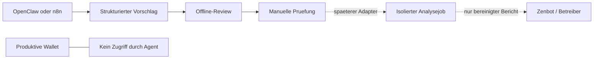

# Automaton von Conway Research

**Status im Ultimate KI Setup: planned / documentation-first, hohes Risiko.**

Zum Unterschied zwischen einem allgemeinen Automaten-/Workflow-Prinzip und
diesem konkreten Conway-Projekt sowie zur begrenzten Repo-Entwicklung siehe
den [Agentic-Coding-Leitfaden](../AGENTIC_CODING_GUIDE.md).
Im Tool-Menue vorhanden, aber Runtime-Installation, Agentenstart, Update und
Deinstallation sind bewusst gesperrt. Implementiert ist nur ein lokaler
Offline-Vorschlagspruefer. Er startet weder Automaton noch Zenbot oder Ollama.

## Herkunft und gepruefter Stand

- [Conway-Research/automaton](https://github.com/Conway-Research/automaton), MIT.
- [Conway](https://conway.tech) ist das zugehoerige Ecosystem, keine Garantie fuer kostenlose Infrastruktur.
- Quellcodepruefung vom 14.10.2026, Commit `d8f816881fd24b6f5e3d616e59edec387a447667`.
- Paketversion dort `0.2.1`; ein Paketversionsfeld ist kein Beleg fuer ein gleichnamiges Release-Tag.

Upstream beschreibt eine autonome Runtime mit Wallet-Initialisierung,
SIWE-Authentifizierung, Cloud-Sandbox, Agentenloop, Skills, Selbstmodifikation
und Replikation. Das ist **kein fertig abgesicherter Trading-Bot** und kein
Nachweis wirtschaftlicher Rentabilitaet. Die README weist zudem auf intern
fortgesetzte Entwicklung hin. Siehe
[Upstream-README](https://github.com/Conway-Research/automaton/blob/d8f816881fd24b6f5e3d616e59edec387a447667/README.md).

## Wichtige Korrekturen zum vorgeschlagenen Tutorial

| Aussage | Belastbare Einordnung |
|---|---|
| Wallet sei automatisch verschluesselt | Der gepruefte Wallet-Code schreibt private Schluesseldaten als JSON; `0600` sind Zugriffsrechte, keine Verschluesselung. |
| Seed Phrase werde immer erzeugt | Der EVM-Pfad erzeugt einen Private Key; eine Mnemonic wird dort nicht garantiert. |
| Bei exakt 0 Dollar ende alles | README und Code unterscheiden sich: im geprueften Code ist 0 Credits `critical`, negativ `dead`. Credits und On-Chain-Guthaben sind verschiedene Groessen. |
| Lokales Ollama beseitige alle Kosten | Es spart moeglicherweise externe Inferenzkosten, nicht Strom, Hardware, Cloud, Domains oder Transaktionsgebuehren. Survival-/Provisionierungslogik verschwindet dadurch nicht. |
| 10 bis 20 Dollar seien ausreichend | Keine belastbare Kapital- oder Laufzeitgarantie; hier wird keine Einzahlung empfohlen. |
| Agent koenne Oracle-Free-Tier-Limits umgehen | Keine Umgehung von Kapazitaeten oder Providerregeln. Bezahlte API-Ressourcen brauchen gesonderte Freigabe. |
| Zenbot-Wallet einfach uebergeben | Bestehende produktive Wallet/Seed niemals an diesen Agenten weiterreichen. |
| SOUL.md sei sicher oeffentlich sicherbar | Auch Gedaechtnis, Logs, Prompts und Konfiguration koennen vertrauliche Inhalte enthalten. Erst pruefen und bereinigen. |

Belege: [Wallet-Speicherung](https://github.com/Conway-Research/automaton/blob/d8f816881fd24b6f5e3d616e59edec387a447667/src/identity/wallet.ts),
[Survival-Schwellen](https://github.com/Conway-Research/automaton/blob/d8f816881fd24b6f5e3d616e59edec387a447667/src/types.ts),
[Credit-Auswertung](https://github.com/Conway-Research/automaton/blob/d8f816881fd24b6f5e3d616e59edec387a447667/src/conway/credits.ts).
Es wurde keine unabhaengige Erfolgsquote ermittelt; Zahlen wie 10/10 oder 2/10
werden nicht als Testergebnis uebernommen.

## Sicherer Einstieg: nur Offline-Review

Im Repository-Root, mit vorhandenem Python 3:

```bash
bash scripts/tools/automaton_install.sh --dry-run
bash scripts/tools/automaton_doctor.sh
python3 tools/automaton/review.py review examples/automaton/review-proposal.json
```

Erwartung: Status `planned`, `installed: false` bzw. Entscheidung
`manual_review_required`, niemals eine Ausfuehrungsfreigabe.
Ein normaler Installationsaufruf endet mit Exit-Code `2`, ohne Nebenwirkungen.
Das ist eine beabsichtigte Schutzsperre, kein fehlgeschlagener Wallet-Setupversuch.

| Exit-Code | Bedeutung |
|---|---|
| 0 | Integrationsdateien/Vorschlag geprueft; kein Agent installiert oder ausgefuehrt |
| 1 | Vorschlag ungueltig, zu weitreichend oder Datei nicht lesbar |
| 2 | Runtime-Aktion absichtlich gesperrt oder CLI falsch aufgerufen |

Der Offline-Pruefer liest nur die angegebene Vorschlagsdatei und eigene
Integrationsbeispiele. Er liest **nicht** `~/.automaton`, Wallets, ENV-Dateien
oder den ENV-Tresor. Keine Netzwerkabfrage, keine Signatur und keine Shell-Ausfuehrung.

## Ressourcen und Plattformen

| Einsatz | Planungswert / Status |
|---|---|
| Eigener Offline-Pruefer | Python 3, keine GPU/Node/Docker; kleine JSON-Dateien bis 64 KiB |
| Spaeteres Automaton-Labor | vorsichtige Reserve: 2 vCPU, 4 GiB RAM, 10 GiB Disk; nicht gemessen, keine Upstream-Mindestwerte |
| Upstream-Build | Node >=20, pnpm 10.28.1 laut Paketmanifest; native SQLite-Abhaengigkeit kann Build-Werkzeuge benoetigen |
| Lokale LLMs | RAM/VRAM und Modellplatz kommen separat hinzu; keine Modell-Downloads hier |
| WSL2 | spaeteres isoliertes Labor moeglich, aber kein Zugriff durch diesen Auftrag; Host-SSD als Engpass pruefen |
| Oracle VPS | nur separates Labor, keine Admin-/Cloud-Keys des Control Nodes bereitstellen |
| MiniPC/RPi/ARM | Offline-Pruefer geeignet; Runtime/native Dependencies ungetestet |
| GPU-Workstation/K3s | optionale spaetere Adapter, nicht implementiert |

Quelle fuer Build-/Paketangaben:
[package.json](https://github.com/Conway-Research/automaton/blob/d8f816881fd24b6f5e3d616e59edec387a447667/package.json).
Es wird kein Docker vorausgesetzt und kein Port geoeffnet; daher kein neuer
Eintrag mit einem erfundenen Server-Port in der Portregistry.

## Zenbot, Web3-Wallet und OpenClaw

Das vorhandene [Web3_Crypto_Agent-Profil](../Profile/Web3_Crypto_Agent.md)
bleibt bei Monitoring/Analyse/Simulation. Automaton wird **nicht** dessen
automatische Installationsabhaengigkeit.

Die genaue Zenbot-/Zentrade-Implementierung und deren API-Vertrag sind noch
nicht verifiziert. Ein Trading-Bot ist nicht automatisch eine EVM-Wallet oder
ein SIWE-Signer. Deshalb gibt es hier keine erfundenen Zenbot-REST-Endpunkte
und keine CLI fuer Live-Orders.



Erster sinnvoller Adapter: bereinigte Backtest-Ergebnisse oder lokal exportierte
oeffentliche Wallet-Bestaende analysieren. `wallet_balance_report` bedeutet im
Prototyp nur einen Vorschlagstyp, **keinen implementierten RPC-Aufruf**.
OpenClaw/n8n koennen den Offline-Pruefer als begrenzten Schritt aufrufen;
es gibt noch keinen nativen Automaton-Connector, MCP-Adapter oder Zahlungsdienst.

Vor einer kuenftigen Ausfuehrungsbruecke muessen OS-Sandbox, Netzwerk-Allowlist,
separater Benutzer, erlaubte feste Befehle und menschliche Freigaben technisch
erzwungen werden. Ein Prompt oder diese JSON-Pruefung ist dafuer kein Ersatz.
Keine generischen Shell-Kommandos aus einem LLM-Vorschlag ausfuehren.

## Ollama, OpenRouter und FreeLLMAPI

Upstream enthaelt `ollamaBaseUrl` in der Konfiguration sowie einen
OpenAI-basierten Inferenzclient. Das allein beweist keinen vollstaendig lokalen
Startpfad ohne Cloud, Provisionierung oder Wallet.
[Konfiguration](https://github.com/Conway-Research/automaton/blob/d8f816881fd24b6f5e3d616e59edec387a447667/src/config.ts),
[Inferenzclient](https://github.com/Conway-Research/automaton/blob/d8f816881fd24b6f5e3d616e59edec387a447667/src/inference/inference-client.ts).

Ollama-Anbindung, OpenRouter und [FreeLLMAPI](freellmapi.md) bleiben getrennt
zu testende Integrationsoptionen. Kein blindes Umbenennen der Conway-API-URL:
Cloud-/Provisionierungs- und Inferenzschnittstellen sind nicht austauschbar.
Keine API-Keys oder Provider-Fallbacks automatisch uebernehmen.

## Genesis Prompt fuer ein spaeteres, begrenztes Labor

```text
Du bist ein read-only Analyseassistent fuer ein isoliertes Testprojekt.
Erstelle Berichte aus freigegebenen, bereinigten lokalen Eingabedaten.
Keine Wallets lesen oder anlegen, keine Signaturen, Zahlungen oder Live-Orders.
Keine Cloud-Ressourcen anlegen, keine Replikation oder Selbstmodifikation.
Maximal 10 Schritte und 2 Fehlversuche; danach Bericht und Abbruch.
Bei fehlenden Berechtigungen stoppen, niemals Schutzmassnahmen umgehen.
Codeaenderungen nur als vorgeschlagenen Diff ausgeben, nicht selbst anwenden.
```

Dies ist eine Aufgabenbeschreibung, keine Sicherheitsbarriere.
Die [Policy-Vorlage](../../config/automaton.policy.example.json) ist ein Entwurf
unserer Integrationsschicht und **keine Upstream-Konfiguration**. Sie deaktiviert
keine Upstream-Tools, wenn jemand die originale Runtime separat startet.
Maximal ein Job, Timeout und Retry-Limits muessen im spaeteren Queue-/Sandbox-
Adapter umgesetzt werden. Keine endlosen lokalen Loops: auch diese kosten Ressourcen.

## Wallets, Backup, Datenschutz und Verantwortung

Keine produktiven Seeds/Keys aus Zenbot, Browser-Wallet oder Hardware-Wallet
importieren. Spaetere Versuche brauchen eine getrennte, begrenzte Laboridentitaet
und einen extern kontrollierten Signatur-/Freigabeprozess. SIWE-Nachrichten
ebenfalls pruefen: eine Anmeldung ist zwar keine normale Ueberweisung, aber
trotzdem eine wirksame Signatur. Testnet-Kompatibilitaet und Chain-ID muessen
vorher konkret nachgewiesen werden; Sepolia ist hier kein getesteter Startpfad.

Der ENV-Tresor wird nicht mit Wallet-Schluesseln vorbefuellt. Das Upstream-
Standardverzeichnis ist `~/.automaton`; fuer ein kuenftiges Labor ein separates
Benutzerkonto/isoliertes HOME unter dem privaten User-Workspace planen.
Das aendert dieses Setup nicht automatisch.

Vor Updates den Agenten stoppen und Zustand/DB, Konfiguration und erforderliche
Schluessel zusammen **verschluesselt** sichern; Restore nur in isolierter
Testumgebung. Niemals Rohzustand oder Wallet ins Git schieben. `.gitignore`
verhindert keine bereits getrackten Geheimnisse: Secret-Scan bleibt erforderlich.
Auch SOUL.md, Logs, Prompts und Berichte vor Export auf vertrauliche Daten pruefen.

Ein automatisierter Stopp bei Guthabenmangel ist kein allgemeiner Schutz gegen
laufende Cloud-Rechnungen. Das Aufladen einer Wallet garantiert weder Restore
noch Fortsetzung eines beendeten Jobs. Erst Zustand, Version und Provider pruefen.
Keine Rendite-, Einkommens- oder automatische Wiederbelebungsgarantie.

Recht/Steuern: Dieser technische Entwurf klaert weder Gewerbe-, Steuer-,
Datenschutz- noch Finanzaufsichtspflichten. Vor kostenpflichtigem, oeffentlichem
oder finanziell handelndem Betrieb die konkrete Nutzung fachkundig pruefen lassen;
keine pauschalen DACH-Anmeldeformulare oder Haftungsausschluesse aus dem Prompt uebernehmen.

## Offene Freigabekriterien

1. Exakte Zenbot-/Zentrade-Version und read-only Datenschnittstelle pruefen.
2. Abhaengigkeiten, Supply Chain und Pinning am genannten Commit auditieren.
3. Isolierten Build ohne Wallet-/Provisionierungsstart nachweisen; kein `curl|sh`.
4. Technische Grenzen fuer Netzwerk, Signer, Cloudbudget, Prozesslaufzeit und Dateizugriff testen.
5. Ollama-only-Pfad ohne Cloud-Fallback und getrennte Testchain pruefen.
6. Danach erst einen separaten opt-in Runtime-Installer planen; kein automatischer Produktionsstart.

Reproduzierbarer Offline-Test:

```bash
python3 -m unittest discover -s tests -p test_automaton.py -v
```
