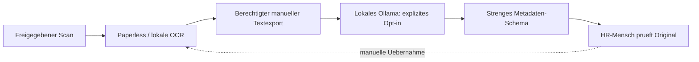

# Lokale Personalakten und Dokumenten-KI

Stand: 14.10.2026. Profil `Personalakten_Local_First`: **planned**.
Vorschlags-CLI und neuer Paperless-Installationspfad: **experimental**, nicht
fuer echte Personalakten freigegeben. Kein fertiger Factorial-Nachbau und keine
automatische DSGVO-/GoBD-Zertifizierung.

## Bausteine statt doppelter Installationen

| Tool | Quelle | Aufgabe / Stand |
|---|---|---|
| Paperless-ngx | [GitHub](https://github.com/paperless-ngx/paperless-ngx) | Bereits registriert; Dokumentablage, OCR, Suche und Berechtigungen |
| Tesseract | [GitHub](https://github.com/tesseract-ocr/tesseract) | OCR; bei Container-Paperless nicht nochmals separat installieren |
| Ollama | [GitHub](https://github.com/ollama/ollama) | Bereits registrierte lokale Inferenz; kein automatischer Modell-Download |
| Personnel_Documents_AI | [Integrationscode](../../tools/personnel_documents/README.md) | Neuer lokaler Prototyp: begrenzte JSON-Vorschlaege, kein Paperless-Schreibzugriff |
| Open WebUI, Qdrant, LangChain, LlamaIndex | vorhandene Setup-Tools | Optional spaeter; fuer HR ausdruecklich nicht pauschal aktivieren |
| Restic/Borg | vorhandene Backup-Kandidaten | Verschluesselte Sicherung planen; kein automatischer GoBD-Nachweis |

Urlaubsverwaltung, Zeiterfassung, Lohnabrechnung, Bewerbermanagement und
Mitarbeiterportal sind damit noch nicht implementiert. Lokaler Betrieb spart
nicht automatisch alle Kosten: Hardware, Strom, Administration und Rechtspflege bleiben.

## Architektur und Sicherheitsgrenze



Der Prototyp verarbeitet genau eine explizit angegebene UTF-8-Datei bis 64 KiB.
Er ruft keine Paperless-API auf und schreibt keine Akte, Berechtigung oder Tags.
Ausgabe: Dokumenttyp, Dokumentdatum, optionales Vertragsende und eine immer
gesetzte menschliche Pruefpflicht. Namen, Gehaelter, Diagnosen und Freitext sind
im Ausgabeschema nicht vorgesehen. **Die Eingabe an das Modell kann trotzdem
sensibel sein; die kleine Ausgabe anonymisiert nicht die Verarbeitung.**
Unbekannte Daten sind `null`; Halluzinationen bleiben moeglich.
`absence_document` setzt zusaetzlich einen Hinweis auf besondere Zugriffspruefung.

## Schritt 1: gefahrlos mit synthetischen Daten beginnen

Im Repository-Root, Python 3.10+ vorhanden:

```bash
bash scripts/tools/personnel_documents_install.sh --dry-run
python3 tools/personnel_documents/pipeline.py validate \
  --input examples/personnel_documents/proposal.json
```

Erwartung: `human_review_required: true`, `applied: false`. Kein Netzwerk,
keine Installation und keine echten Personalunterlagen.
Die Install-/Update-/Uninstall-Wrapper des neuen Tools liefern ohne Dry-Run
bewusst Exit-Code 2: der Prototyp wird direkt aus dem Repository verwendet und
installiert weder Paperless noch Modelle oder Python-Abhaengigkeiten.

## Schritt 2: optional lokale KI pruefen

Nur wenn ein zuvor geprueftes lokales Modell bereits in Ollama vorhanden ist:

```bash
python3 tools/personnel_documents/pipeline.py infer \
  --input examples/personnel_documents/synthetic-document.txt \
  --model LOCAL_MODEL_NAME --allow-local-inference
```

`LOCAL_MODEL_NAME` durch dessen lokalen Modellnamen ersetzen. Kein Modell wird
automatisch geladen. Die CLI verbindet ausschliesslich zu
`http://127.0.0.1:11434/api/generate`, ohne Umgebungsproxy oder HTTP-Redirects,
mit Timeout, begrenzter Ausgabe und ohne automatische Wiederholungen.
Modellnamen mit `cloud` werden abgelehnt; das ist **kein Beweis**, dass ein
fremder lokaler Proxy oder die Modellruntime offline arbeitet. Ausgehendes Netz,
Runtime-Logging, Telemetrie und Modellherkunft separat kontrollieren.
Die Anfrage nutzt [Ollamas Generate-API](https://docs.ollama.com/api/generate)
mit JSON-Schema; dies ersetzt keine Pruefung der sachlichen Richtigkeit.
CLI-Logs enthalten weder OCR-Text noch rohe Modellantworten; ausgegebene
Metadaten und Terminal-Aufzeichnungen ebenfalls vertraulich behandeln.
Nie ueber FreeLLMAPI/OpenRouter oder einen Cloud-Fallback auf echte Akten zugreifen.

## Schritt 3: Paperless erst im Testsystem einrichten

Im alten Installer waren ein festes Datenbankpasswort und `8010:8000` auf allen
Schnittstellen hinterlegt. Der neue Pfad verwendet private Secrets,
`127.0.0.1:8010:8000`, persistente DB-/Dokumentordner und Docker-Opt-in.
**Vorhandene Installationen werden dadurch nicht nachtraeglich gehaertet.**

```bash
bash scripts/tools/paperless_ngx_install.sh --dry-run
```

Erst danach die [ENV-Vorlage](../../config/paperless_ngx.env.example) im privaten
Pfad `~/.openclaw_ultimate_user_data/env/paperless_ngx/.env` bereitstellen,
Rechte `0600`. DBPASS und SECRET_KEY sind getrennte, zufaellige 64-Hex-Werte,
lokal im Passwortmanager erzeugt. Keine echten Werte ins Repo oder Terminalprotokoll.
Mit dem [ENV-Tresor](../ENV_VAULT.md), wenn bereits eingerichtet:

```bash
python3 scripts/security/env_vault.py set paperless_dbpass
python3 scripts/security/env_vault.py set paperless_secret_key
python3 scripts/security/env_vault.py bind paperless_ngx PAPERLESS_DBPASS paperless_dbpass
python3 scripts/security/env_vault.py bind paperless_ngx PAPERLESS_SECRET_KEY paperless_secret_key
python3 scripts/security/env_vault.py render paperless_ngx
python3 scripts/security/env_vault.py render paperless_ngx --apply
```

In der privaten ENV anschliessend `PAPERLESS_IMAGE` auf eine konkret gepruefte
numerische Version aus den [offiziellen Releases](https://github.com/paperless-ngx/paperless-ngx/releases)
setzen. Der Platzhalter und `latest` werden abgelehnt; kein aktuellster
Versionstag wird ungeprueft automatisch geladen. Vorhandene Secrets nicht
blind ersetzen. Redis/Postgres verwenden noch Major-Tags; Digest-Pinning und
Upgrade-/CVE-Pruefung bleiben vor Produktivbetrieb offen.

```bash
# Erst nach Pruefung: vorhandene Docker Engine/Compose wird vorausgesetzt.
PAPERLESS_ENABLE_DOCKER=1 bash scripts/tools/paperless_ngx_install.sh
```

Keine automatische Engine-Installation, Gruppen-/Socket-Aenderung oder
Admin-Passworterzeugung. Daten liegen fuer neue Installationen unter
`~/.openclaw_ultimate_user_data/tools/paperless_ngx/`.
Admin interaktiv nach Upstream-Anleitung anlegen, danach gesonderte HR-Gruppen
und Benutzer. HTTP-Ping nach Start prueft weder OCR noch ACL oder Compliance.
Das Setup-Menue schreibt das vorhandene Installationslog; Compose-Ausgaben
nicht mit einem unredigierten `config`-Dump inklusive Secrets erweitern.

**Migration:** Existiert `/opt/paperless_ngx`, stoppt der neue Installer und
Deinstaller absichtlich. Kein paralleler leerer Stack, kein automatischer
Umzug und kein Datenbank-Passwortwechsel. Erst konsistentes Backup/Export und
Restore-Test mit identischer Version planen; Aenderungen am echten System
bleiben manuell freizugeben. Bestehende Compose-Projektnamen und Datenpfade
muessen dabei erhalten bzw. bewusst migriert werden.

```bash
# Fuer den NEUEN Stack: stoppt Container, behaelt ENV/DB/Dokumente.
PAPERLESS_ENABLE_DOCKER=1 bash scripts/tools/paperless_ngx_uninstall.sh
```

## Ressourcen

| Ziel | Planung, nicht gemessener Mindestbedarf |
|---|---|
| Paperless ohne LLM | mindestens 2 GiB RAM/10 GiB freie Disk als Installer-Reserve; 4 GiB RAM fuer kleines Testsystem sinnvoll einplanen |
| WSL2 | zusaetzlich 20 GiB freie Windows-Host-Reserve; SSD-/VHDX-Wachstum und echten Speicherort pruefen |
| Lokales Modell | RAM/VRAM/Modellspeicher separat; OCR und Inferenz zunaechst seriell |
| RPi/ARM | OCR langsamer, Images/Version/Sprachpakete testen; kein Produktionsnachweis |
| VPS/K3s | optional, nicht Pflicht; keine HR-Dienste oder Datenbanken oeffentlich freigeben |

Gesamt-RAM-/Disk-Pruefungen ersetzen keine Messung von Spitzenlast unter OCR
und Inferenz. Die Pipeline startet pro Aufruf eine Anfrage; mehrere Prozesse
werden **nicht** global serialisiert. Fuer spaetere Automation die bestehende
Job-Queue mit Parallelitaet 1 und externem Timeout verwenden.

## Berechtigungen, RAG und spaetere Automation

Paperless bietet API und Objektberechtigungen. Zugriff muss mit mehreren
Benutzern/Gruppe getestet werden: HR, Lohnabrechnung, Vorgesetzte und
Mitarbeitende duerfen nicht automatisch dieselben Dokumente sehen.
Geteilte Tags sind keine ausreichende Sicherheitsgrenze. Keine Superuser-Tokens
fuer den KI-Worker; minimal berechtigtes Servicekonto, kein globaler Lesezugang.
Siehe [API und Permissions](https://github.com/paperless-ngx/paperless-ngx/blob/main/docs/api.md).

Ein spaeterer Adapter darf zunaechst nur berechtigte einzelne Dokument-IDs per
`GET /api/documents/{id}/` lesen. `PATCH`, Tag-/Datumszuordnung und Webhooks
bleiben **nicht implementiert** und brauchen Freigabe, Versionspruefung,
Idempotenz, Audit-Ereignisse und Schutz vor Prompt-Injection. Quelltext aus
Dokumenten ist untrusted, keine Arbeitsanweisung fuer OpenClaw.
OCR-/Originaldaten nicht in generische n8n-Execution-Logs oder Agentengedaechtnisse kopieren.

Kein gemeinsamer Personalakten-Index in Open WebUI/Qdrant: ACL muss vor der
Suche und bei jedem Treffer inkl. Cache, Embeddings und Zitaten durchgesetzt
werden. Rechteentzug/Loeschung muss auch Sekundaerindizes und gespeicherte
Antworten erreichen. Erst synthetische Mandanten-/ACL-Tests, dann Freigabe.

## Datenschutz und Nachweisbarkeit

**Lokal ist nicht automatisch DSGVO-konform.** Zweck, Rechtsgrundlage,
Datenminimierung, Information der Beschaeftigten, Verarbeitungsverzeichnis,
Zugriffsprozesse und technische/organisatorische Massnahmen muessen fuer den
konkreten Betrieb geprueft werden. Beschaeftigtendaten und Gesundheitsdaten
brauchen besondere Aufmerksamkeit; keine pauschale Einwilligung als Loesung.
Keine automatisierten Bewertungen von Leistung, Eignung oder Kuendigung.
Quellen: [DSGVO, amtliche Fassung](https://amtliche-handbuecher.bundesfinanzministerium.de/ao/2026/Datenschutz-Grundverordnung/inhalt.html),
[§ 26 BDSG](https://www.gesetze-im-internet.de/bdsg_2018/__26.html).

| Bereich | Vor Produktivbetrieb nachweisen |
|---|---|
| Zugriff | negative ACL-Tests, Trennung Gesundheits-/Gehaltsdaten, Freigabe-/Entzugsprozess, MFA soweit verfuegbar |
| Verschluesselung | Host-/Backupverschluesselung und Schluesselwiederherstellung; Container/Paperless verschluesseln Dateien nicht automatisch |
| Transport | lokale Testadresse nur localhost; Remotezugriff per VPN und TLS/Authentifizierung, nie offene Admin-Panels |
| Fristen | je Dokumentklasse fachlich freigegebene Frist, Beginn, Sperr-/Legal-Hold-Regeln; keine universelle Frist oder automatische KI-Loeschung |
| Betroffenenrechte | Auskunft, Berichtigung, Export und gepruefte Loeschung mit Sekundaerspeichern/Backups planen |
| Audit | Zugriff/Aenderung/Freigabe mit Akteur, Zeit und Dokumentreferenz; keine ganzen Akten/Secrets in Logs, Log-ACL und Fristen |

LUKS wird hier nicht eingerichtet: Laufwerksverschluesselung kann bei
Fehlbedienung Daten vernichten. Verantwortliche und Datenschutzbeauftragte
muessen das Gesamtkonzept pruefen; keine Rechtsberatung oder Zertifizierung.

## Backup, GoBD und Restore

Restic/Borg, Snapshots oder eine lokale Logdatei allein ergeben keine
Revisionssicherheit. Fuer steuerlich relevante Unterlagen muessen die jeweils
anwendbaren GoBD-Anforderungen, Verfahren und Nachweise gesondert geprueft
werden; nicht jede Personalakte ist pauschal ein GoBD-Archiv.
Quelle: [BMF: GoBD im amtlichen Handbuch](https://amtliche-handbuecher.bundesfinanzministerium.de/ao/2026/Anhaenge/BMF-Schreiben-und-gleichlautende-Laendererlasse/Anhang-33/inhalt.html).

DB-Dump/Originale/Archivdateien/Metadaten/Config konsistent sichern, Secrets
separat verschluesselt verwalten. Mindestens eine getrennte geschuetzte Kopie
und Wiederherstellung mit identischer Version/Schluesseln testen. Ein Backup
aus der bisherigen Installation ohne persistente DB muss besonders geprueft
werden. Append-only und unveraenderbare Medien nur mit getesteter Konfiguration
und unabhaengigen Zugangsdaten als Schutzmassnahme bewerten.
**Wichtig:** Das allgemeine unverschluesselte Setup-Backup schliesst die neuen
User-Workspace-Pfade `tools/paperless_ngx/` und `personnel_documents/` absichtlich
aus. Es ist damit kein vollstaendiges Aktenbackup! Vor echten Daten einen
separaten verschluesselten Backupjob samt Restore-Test einrichten. Alte Backups
und Legacy-Pfade werden nicht automatisch bereinigt oder verschluesselt.
Loeschungen bei Restore erneut anwenden, damit geloeschte Akten nicht dauerhaft
wieder auftauchen; Backup-Fristen/Legal Holds fachlich abstimmen.

## Offen und bewusst nicht automatisiert

- Echter Docker-/OCR-/ARM-/WSL- und Restore-Test; Image-Digest/CVE-/Sprachpaketpruefung.
- Paperless-Legacy-Migration, produktive Nutzer/Rollen und TLS/MFA.
- Paperless-API-Leseadapter, freigegebener Schreibadapter, idempotente n8n-/OpenClaw-Workflows.
- ACL-sicheres RAG und Aufbewahrungs-/Loeschprozess; keine Zertifizierung.
- Abwesenheitsantraege, Lohnabrechnung, Arbeitsrecht oder Factorial-Funktionsparitaet.

Tests ohne echte Dokumente oder laufende Dienste:

```bash
python3 -m unittest discover -s tests -p test_personnel_documents.py -v
```
